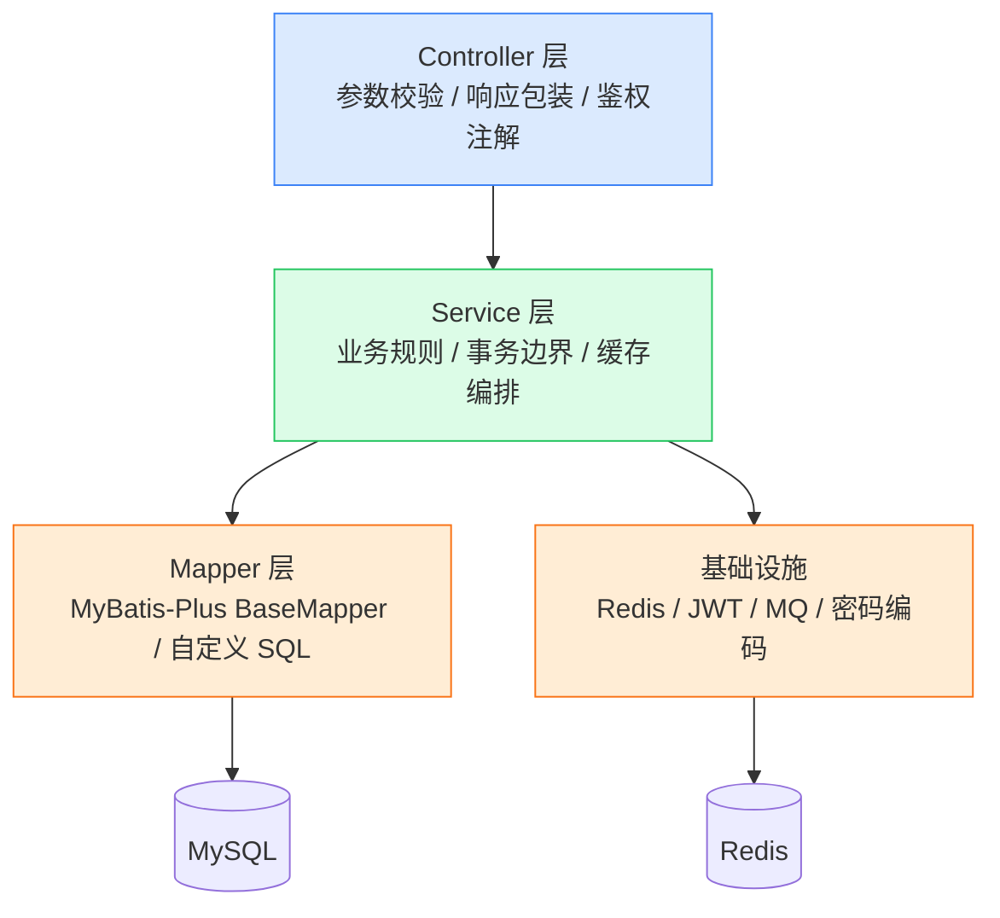
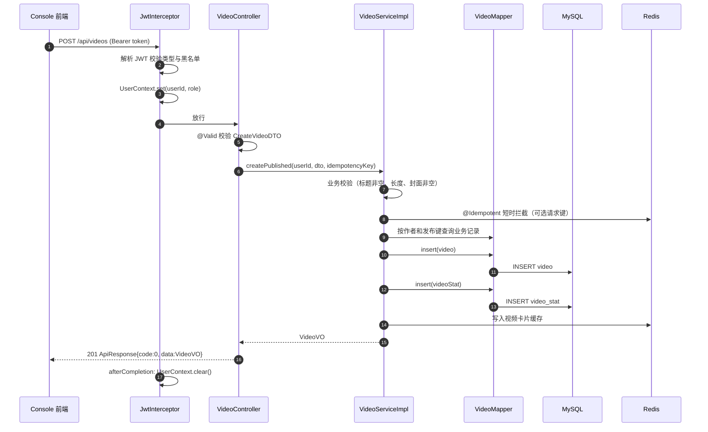
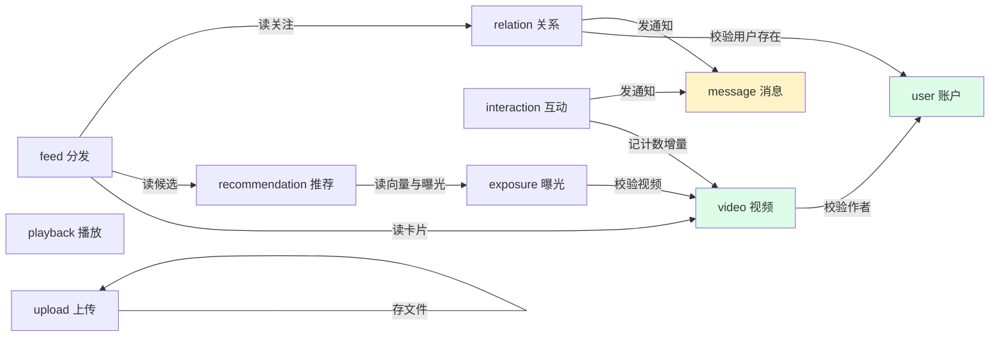
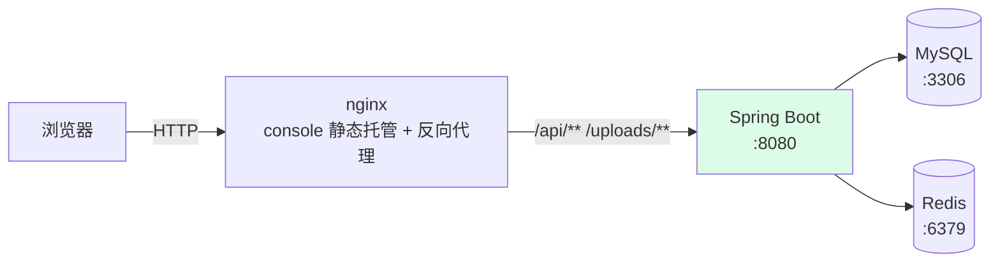

# 01 总体架构设计

## 1. 设计目标

把 Go 版 GCFeed 的短视频 Feed 系统用 Spring Boot 重写，达成三个目标：

1. **功能等价**：账户、视频、互动、Feed、推荐、关系、消息、播放优化的能力与接口语义一致。
2. **Java 化**：按 Java 社区的经典分层（Controller / Service / Mapper）组织代码，而不是照搬 Go 的 DDD 四层目录。
3. **修掉原设计的毛病**：响应体不统一、内部接口无鉴权、MQ 无死信、事务边界下沉等，在重写时一并纠正。

## 2. 分层模型

采用经典四层，依赖方向严格单向向下，禁止跨层调用与反向依赖。



| 层 | 职责 | 禁止事项 |
| --- | --- | --- |
| **Controller** | 解析 path/query/body/header；读取 `UserContext`；调用 Service；把结果转成 VO；不做业务判断 | 禁止写业务规则、禁止直接调 Mapper、禁止开启事务 |
| **Service** | 业务规则校验、事务边界、跨模块编排、缓存读写、领域事件发布 | 禁止处理 HTTP 语义（HttpServletRequest、ResponseEntity） |
| **Repository** | 组合多个 Mapper、封装查询和持久化细节 | 禁止承载业务规则和 HTTP 语义 |
| **Mapper** | 数据持久化，MyBatis-Plus 的 `BaseMapper` + 少量注解 SQL | 禁止写业务逻辑、禁止跨表业务编排 |
| **Entity / DTO / VO** | Entity 映射数据库行；DTO 接收请求；VO 返回响应 | 禁止在 VO 中暴露密码等敏感字段 |

### 2.1 为什么用经典四层而不是 DDD 四层

Go 版的 `domain / application / infra / interfaces` 四层在 Go 里很自然，因为 Go 用接口做依赖倒置、无框架侵入。但搬到 Java 会产生明显的样板税：

- 简单模块直接使用 `BaseMapper` 即可；视频这类需要组合 `video` 与 `video_stat` 的模块再引入 `Repository`，避免 Service 直接编排多个 Mapper。
- Java 的依赖注入由 Spring 容器管理，接口与实现的分离通过 `@Service` / `@Mapper` 已经完成，不需要额外的 Repository 接口层。

因此保留「领域规则集中在 Service」这一核心约束（对应 Go 的 domain + application），去掉纯粹的接口转接层，把持久化收敛到 Mapper。

## 3. 包结构

根包 `io.github.gmjneko.gcfeed`。

```text
src/main/java/io/github/gmjneko/gcfeed/
├── GcFeedApplication.java              启动类
│
├── common/                             全局通用组件（技术基础设施）
│   ├── api/
│   │   ├── ApiResponse.java            统一响应体
│   │   └── ErrorCode.java              全局错误码枚举
│   ├── annotation/
│   │   ├── RequireAuth.java            必须登录
│   │   └── OptionalAuth.java           可选登录
│   ├── constant/
│   │   ├── CommonConstant.java         通用常量与字段长度上限
│   │   └── RedisKeyConstant.java       Redis 键模板与 TTL
│   ├── context/
│   │   └── UserContext.java            ThreadLocal 用户上下文
│   ├── exception/
│   │   ├── BusinessException.java      业务异常
│   │   └── GlobalExceptionHandler.java 全局异常处理器
│   ├── interceptor/
│   │   ├── JwtInterceptor.java         JWT 鉴权拦截器
│   │   └── InternalTokenInterceptor.java 内部接口鉴权
│   └── jwt/
│       ├── JwtProperties.java          JWT 配置
│       ├── JwtPayload.java             载荷对象
│       ├── JwtUtil.java                签发与校验
│       └── TokenBlacklist.java         登出黑名单
│
├── config/                             基础设施装配
│   ├── AuthenticationConfiguration.java JWT、黑名单与密码编码器
│   ├── WebMvcConfiguration.java        鉴权拦截器、跨域、静态资源
│   ├── RedissonConfiguration.java      Redisson 客户端（按需建连）
│   └── MybatisPlusConfiguration.java   Mapper 扫描、分页、防误更新、自动填充
│
├── modules/                            业务模块
│   ├── user/                           账户模块
│   │   ├── controller/UserController.java
│   │   ├── service/UserService.java + impl/UserServiceImpl.java
│   │   ├── mapper/UserMapper.java
│   │   ├── entity/User.java
│   │   ├── dto/                        请求对象
│   │   └── vo/                         响应对象
│   ├── video/                          视频模块
│   ├── interaction/                    互动模块（点赞/收藏/评论）
│   ├── relation/                       关系模块（关注/粉丝）
│   ├── feed/                           Feed 分发模块
│   ├── recommendation/                 推荐模块
│   ├── exposure/                       曝光与观看行为模块
│   ├── message/                        站内消息模块
│   ├── playback/                       播放优化模块
│   └── upload/                         文件上传模块
│
└── (未来) job/                         定时任务与 MQ 消费者
```

### 3.1 单模块的内部结构

以 `video` 模块为例：

```text
modules/video/
├── controller/
│   └── VideoController.java       # REST 入口，@Valid 校验，返回 ApiResponse<VideoVO>
├── service/
│   ├── VideoService.java          # 接口
│   └── impl/VideoServiceImpl.java # 实现，@Transactional 边界在这里
├── mapper/
│   └── VideoMapper.java           # extends BaseMapper<Video>
├── entity/
│   ├── Video.java                 # 对应 video 表
│   └── VideoStat.java             # 对应 video_stat 表
├── dto/
│   ├── CreateVideoDTO.java
│   └── VideoQueryDTO.java
└── vo/
    ├── VideoVO.java
    └── VideoListVO.java
```

## 4. 一次请求的完整链路

以「发布视频」为例：



关键点：

1. **拦截器早于 Controller**，非法令牌在进入业务前就被拒绝，不会消耗 Service 资源。
2. **`UserContext` 由拦截器写入**，Controller 通过 `UserContext.requireUserId()` 获取当前用户，无需在每个方法上写 `@RequestAttribute`。
3. **事务边界在 Service**，`@Transactional` 保证 `video` 与 `video_stat` 两张表同时成功或同时失败。
4. **响应由 Controller 包装**，Service 只返回 VO，不感知 HTTP。
5. **`UserContext.clear()` 在 `afterCompletion` 中执行**，因为 Tomcat 线程池会复用线程。

## 5. 模块依赖关系



**依赖原则**：

- 模块之间通过 **Service 接口** 调用，不直接引用对方的 Mapper。例如 `InteractionServiceImpl` 需要更新计数时，调 `VideoStatService`，而不是直接操作 `VideoStatMapper`。
- `message` 模块被 interaction 与 relation 依赖，但 message **不反向依赖**任何模块 —— 它只接收 `MessageWriter` 接口调用。这是为了避免循环依赖。
- 消息写入属于「尽力而为」：失败只记日志，绝不影响主流程的成功返回（原项目也是这个语义，保留）。

## 6. 关键技术决策

### 6.1 为什么对象分 Entity / DTO / VO 三种

| 类型 | 用途 | 示例 |
| --- | --- | --- |
| **Entity** | 与数据库表一一对应，字段名用驼峰，由 MyBatis-Plus 映射 | `User`、`Video` |
| **DTO** | 接收请求参数，带 `@NotBlank` 等校验注解 | `RegisterDTO`、`CreateVideoDTO` |
| **VO** | 返回给前端，只含该接口需要的字段 | `UserVO`、`PublicUserVO` |

这样做的收益：注册接口接收的 `RegisterDTO` 含 `password`，返回的 `UserVO` 不含 `password`。如果只用 Entity 一个类，就很容易把密码哈希泄漏出去（原项目用 `userProfileResponse` / `publicUserProfileResponse` 两个 struct 做区分，思路一致）。

### 6.2 时间类型选型

统一使用 `LocalDateTime`，不用 `Instant`：

- 数据库列是 `DATETIME`（无时区），`LocalDateTime` 与它一一对应，不会有隐式时区换算。
- JDBC 连接串已指定 `serverTimezone=Asia/Shanghai`，应用与数据库时区一致。
- 对外 JSON 统一格式化为 `yyyy-MM-dd HH:mm:ss`（Jackson 全局配置），前端解析简单。

原项目用 Go 的 `time.Time`，JSON 输出为 RFC3339Nano（带 `Z` 或 `+08:00`）。前端 `App.jsx` 的 `formatRelativeTime` 用 `new Date(str)` 解析，两种格式都能识别，所以改动是兼容的。

### 6.3 删除与状态

项目不启用 MyBatis-Plus 全局逻辑删除。有生命周期的实体用 `status` 表达删除，例如 `account.status = 3` 表示注销、`video.status = 4` 表示删除；统计表和流水表不做软删除。查询需要显式带上状态条件，这些条件封装在 Repository 方法里。

例如视频「下架」（`status = 3`）仍能被作者自己看到，「删除」（`status = 4`）对公开查询和作者列表都不可见，但行保留，删除接口和发布幂等可以直接用 `BaseMapper` 读到它。完整约定见 [02 数据库设计 §1.2](02-数据库设计.md)。

### 6.4 Mapper 的组织方式

- 单表 CRUD 用 MyBatis-Plus 的 `BaseMapper`，不写 SQL。
- 多表联查、批量写入等复杂语句写在 `resources/mapper/*.xml` 里，或用 `@Select` 注解。
- 需要手写 SQL 的典型场景：Feed 卡片批量组装（`video` 联 `account`）、热榜仓储兜底查询、账号资料联关系统计表。

## 7. 配置管理

配置分两类：

| 类型 | 位置 | 示例 |
| --- | --- | --- |
| **框架配置** | `application.yaml` 的 `spring.*` | 数据源、Redis、multipart |
| **业务配置** | `application.yaml` 的 `gcfeed.*` | `gcfeed.jwt.secret`、`gcfeed.internal.token`、`gcfeed.upload.root` |

业务配置用 `@ConfigurationProperties` 绑定成对象（如 `JwtProperties`），避免散落 `@Value`。

**敏感配置通过环境变量覆盖**：

```yaml
gcfeed:
  jwt:
    secret: ${GCFEED_JWT_SECRET:gcfeed-dev-only-secret-key-please-change-it-32bytes}
```

默认值是仅用于开发的弱密钥，生产环境必须通过 `GCFEED_JWT_SECRET` 覆盖。`JwtUtil` 构造函数会校验密钥长度不足 32 字节时直接启动失败，防止误用弱密钥上线。

## 8. 部署形态



单一应用进程（单体），与 Go 版一致。`console/nginx.conf` 已配置好 `/api/` 与 `/uploads/` 的反向代理，以及 SPA 的 `try_files ... /index.html` fallback（前端是多段路径路由，必须保留）。

**需要注意的配置对齐**：

| 项 | 位置 | 说明 |
| --- | --- | --- |
| 上传体积 | `nginx.conf` 的 `client_max_body_size 1024m` + `application.yaml` 的 `spring.servlet.multipart.max-file-size` | 两处都要放开，只改一处会在不同环节被拒 |
| 代理超时 | `nginx.conf` 的 `proxy_read_timeout 300s` | 大视频上传需要长超时 |
| 端口 | 后端 8080，前端 dev 5173 | Vite 已配置代理到 8080 |

## 9. 可观测性

- **日志**：SLF4J + Logback，包级日志级别在 `application.yaml` 的 `logging.level` 配置。业务异常记 `warn` 不打印堆栈，未预期异常记 `error` 并打印完整堆栈。
- **指标**：Micrometer 采集 JVM 与 HTTP 指标，暴露在 `/actuator/prometheus`。原项目的自定义业务指标（Feed 耗时、缓存命中、Worker 任务）在实现对应功能时通过 `MeterRegistry` 补充。
- **健康检查**：`/actuator/health`，容器探活使用。原项目的 `/health` 返回固定文案，这里用 Boot 自带端点替代，能真实反映数据源与 Redis 的连通性。
