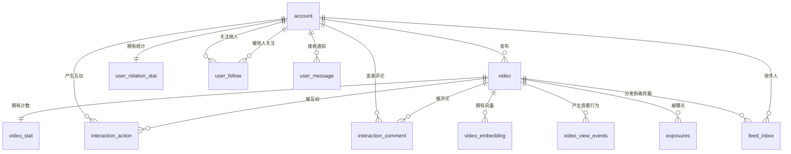
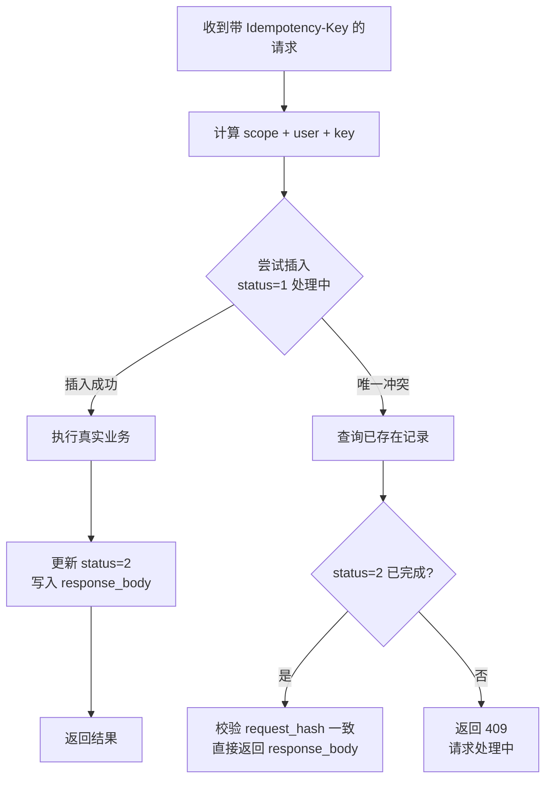

# 02 数据库设计

建表语句见 [`sql/schema.sql`](../sql/schema.sql)，初始化数据见 [`sql/data.sql`](../sql/data.sql)。

数据库：`gcfeed`，字符集 `utf8mb4`，引擎 InnoDB。

## 1. 通用约定

### 1.1 字段约定

| 字段 | 类型 | 说明 |
| --- | --- | --- |
| `id` | `BIGINT AUTO_INCREMENT` | 所有表统一使用自增主键。原项目中 `video_stat` 用 `video_id` 作主键、其余表用 `id`，本版本对统计表保留 `video_id` 主键（一对一表用业务键更自然），其余一律 `id` |
| `deleted` | `TINYINT NOT NULL DEFAULT 0` | 逻辑删除标记，与 `application.yaml` 的 MyBatis-Plus 全局配置对应 |
| `created_at` | `DATETIME NOT NULL DEFAULT CURRENT_TIMESTAMP` | 创建时间，由数据库默认值兜底，同时 MyBatis-Plus 自动填充 |
| `updated_at` | `DATETIME NOT NULL DEFAULT CURRENT_TIMESTAMP ON UPDATE CURRENT_TIMESTAMP` | 更新时间，数据库侧自动刷新 |

### 1.2 为什么需要 `deleted` 列

`application.yaml` 中已经配置：

```yaml
mybatis-plus:
  global-config:
    db-config:
      logic-delete-field: deleted
      logic-delete-value: 1
      logic-not-delete-value: 0
```

这个配置生效的前提是**业务表存在 `deleted` 列**。原 Go 项目用 `status` 字段表达删除（如 `video.status = 4`），但两者职责不同：

- `status` 是**业务状态机**，需要业务代码判断。例如视频作者能看到自己 `status = 3`（下架）的视频，其他人看不到。
- `deleted` 是**通用行级删除**，由 ORM 自动过滤，业务代码不需要关心。例如用户注销后整行不可见。

对比示例（视频的可见性矩阵）：

| 场景 | SQL 条件 |
| --- | --- |
| 公开 Feed | `deleted = 0 AND status = 2 AND published_at IS NOT NULL` |
| 作者的"我的作品" | `deleted = 0 AND status IN (2, 3)` |
| 作者删除自己的视频 | `deleted = 1`（并同步 `status = 4` 保留语义） |

### 1.3 计数字段的钳制

所有计数（`like_count`、`comment_count`、`favorite_count`、`follower_count`、`following_count`）都必须保证非负。原 Go 代码在应用层做 `clampCount`，本版本在 **SQL 层**用 `GREATEST(x - 1, 0)` 保证：

```sql
UPDATE video_stat
SET like_count = GREATEST(like_count - 1, 0)
WHERE video_id = #{videoId}
```

理由：应用层「读取 → 判断 → 回写」在并发下会丢更新（两个请求都读到 1，都减到 0，实际应该减 2 次但结果都是 0，或者更糟）。SQL 层原子递减 + `GREATEST` 钳制是并发安全的。

## 2. 表清单

| 分类 | 表名 | 用途 | 状态 |
| --- | --- | --- | --- |
| 账号 | `account` | 用户凭证与资料 | 已实现 |
| 账号 | `user_follow` | 关注关系 | 已实现 |
| 账号 | `user_relation_stat` | 关注数/粉丝数 | 已实现 |
| 视频 | `video` | 视频主体 | 已实现 |
| 视频 | `video_stat` | 互动计数 | 已实现 |
| 视频 | `video_embedding` | 内容向量 | 已实现 |
| 互动 | `interaction_action` | 点赞/收藏行为 | 已实现 |
| 互动 | `interaction_comment` | 评论 | 已实现 |
| Feed | `feed_inbox` | 关注流收件箱 | 已实现 |
| 曝光 | `video_view_events` | 观看行为流水 | 已实现 |
| 曝光 | `exposures` | 曝光聚合 | 已实现 |
| 消息 | `user_message` | 站内通知 | 已实现 |
| 播放 | `playback_config` | 播放策略配置 | 已实现 |
| 播放 | `playback_qos_log` | 播放质量流水 | 已实现 |
| 治理 | `review_task` | 审核任务 | 规划中 |
| 治理 | `review_decision_log` | 审核日志 | 规划中 |
| 运营 | `admin_config` | 运营配置 | 规划中 |
| 运营 | `admin_action_log` | 操作审计 | 规划中 |
| 治理 | `governance_degrade_switch` | 降级开关 | 规划中 |
| 治理 | `governance_dead_letter` | 死信任务 | 规划中 |
| 监控 | `monitor_metric_point` | 业务指标点 | 规划中 |
| 监控 | `monitor_alert_rule` | 告警规则 | 规划中 |
| 监控 | `monitor_alert_event` | 告警事件 | 规划中 |
| 通用 | `idempotent_record` | 幂等请求记录 | 本版本新增 |

## 3. 实体关系



> 所有外键都是**逻辑外键**，数据库未建 `FOREIGN KEY` 约束。这是分库分表与批量导入的常规做法，一致性由应用层保证。原项目同样无外键。

## 4. 核心表详细设计

### 4.1 `account` 账号表

| 字段 | 类型 | 约束 | 说明 |
| --- | --- | --- | --- |
| `id` | BIGINT | PK | 用户 ID |
| `account` | VARCHAR(64) | NOT NULL, UK | 登录账号，唯一 |
| `password` | VARCHAR(255) | NOT NULL | BCrypt 哈希 |
| `nickname` | VARCHAR(64) | NOT NULL | 昵称 |
| `avatar_url` | VARCHAR(512) | NULL | 头像地址 |
| `bio` | VARCHAR(255) | NULL | 简介 |
| `status` | TINYINT | NOT NULL DEFAULT 1 | 1 正常 2 冻结 3 注销 |
| `role` | VARCHAR(32) | NOT NULL DEFAULT 'user' | user / admin |
| `deleted` | TINYINT | NOT NULL DEFAULT 0 | 逻辑删除 |
| `created_at` / `updated_at` | DATETIME | NOT NULL | 时间戳 |

**索引**

| 名称 | 列 | 用途 |
| --- | --- | --- |
| `uk_account` | `account` | 登录查询 + 注册唯一性校验 |
| `idx_status` | `status` | 后台按状态筛选用户 |

**设计说明**

- 字段名用 `password` 而不是 Go 文档里的 `password_hash`。原 Go 代码实际列名就是 `password`（见 `infra/persistence/account/model.go`），文档与实现不一致，本版本以**实现为准**。
- 密码只存 BCrypt 哈希。`BCryptPasswordEncoder` 默认强度 10，与 Go 的 `bcrypt.DefaultCost` 一致，因此两端产生的哈希可互相校验，迁移期可并行运行。
- **不存 `following_count` / `follower_count` / `work_count`**：这三个数分别来自 `user_relation_stat` 和 `video` 表的聚合。原 Go 实现在账号查询时用 LEFT JOIN 子查询实时统计，本版本沿用该思路（见 4.2 节）。

### 4.2 关于关系统计的读取

原 Go 代码在 `FindByID` / `FindByAccount` 中联了三个子查询：

```sql
LEFT JOIN user_relation_stat AS rs ON rs.user_id = a.id
LEFT JOIN (SELECT user_id, COUNT(*) FROM user_follow WHERE status = 1 GROUP BY user_id) AS active_following
LEFT JOIN (SELECT target_user_id, COUNT(*) FROM user_follow WHERE status = 1 GROUP BY target_user_id) AS active_followers
LEFT JOIN (SELECT author_id, COUNT(*) FROM video WHERE status = 2 GROUP BY author_id) AS published_works
```

这个写法有个问题：**每次查用户资料都要扫三张表做全量聚合**，即使只需要一个用户的数据。

本版本的改法：优先读 `user_relation_stat` 的冗余计数，只在计数行缺失时才回退到实时统计。

```sql
SELECT a.id, a.account, a.nickname, a.avatar_url, a.bio, a.status, a.role,
       COALESCE(rs.following_count, 0) AS following_count,
       COALESCE(rs.follower_count, 0)  AS follower_count,
       (SELECT COUNT(*) FROM video v
        WHERE v.author_id = a.id AND v.status = 2 AND v.deleted = 0) AS work_count
FROM account a
LEFT JOIN user_relation_stat rs ON rs.user_id = a.id
WHERE a.id = #{userId} AND a.deleted = 0
```

- `following_count` / `follower_count` 直接读冗余表：关注/取关时已经维护，读时是主键查询，O(1)。
- `work_count` 仍用子查询：视频数量变化频繁（发布、删除），维护冗余列的成本高于收益，且子查询走 `idx_author_status` 索引，代价可控。

### 4.3 `video` 与 `video_stat`

**`video`**

| 字段 | 类型 | 说明 |
| --- | --- | --- |
| `id` | BIGINT | 视频 ID |
| `author_id` | BIGINT | 作者 ID |
| `title` | VARCHAR(128) | 标题 |
| `description` | VARCHAR(512) | 简介 |
| `media_url` | VARCHAR(512) | 视频地址 |
| `cover_url` | VARCHAR(512) | 封面地址 |
| `status` | TINYINT DEFAULT 2 | 1 草稿 2 上线 3 下架 4 删除 |
| `published_at` | DATETIME NULL | 发布时间，Feed 排序键 |
| `idempotency_key` | VARCHAR(128) NULL | 发布幂等键 |

**`video_stat`**：`video_id` PK + 三个计数 + 时间戳。**一个视频一行**。

**为什么要拆成两张表**

点赞是高频写操作。如果计数直接放在 `video` 表上，每次点赞都会锁住视频行，而这一行同时被 Feed 查询读取，容易产生锁竞争。拆表后：

- `video` 表只在发布/删除时写，读多写少。
- `video_stat` 表高频写，但只被 Feed 计数读取，且能容忍短暂不一致（有 15 秒缓存）。

**索引设计**

| 名称 | 列 | 用途 |
| --- | --- | --- |
| `uk_author_idempotency` | `author_id`, `idempotency_key` | 发布接口幂等，重复提交返回同一视频 |
| `idx_author_status` | `author_id`, `status`, `created_at` | "我的作品" / 作者主页列表 |
| `idx_status_published` | `status`, `published_at`, `id` | Timeline Feed 分页主查询 |

`idx_status_published` 的列顺序与 Feed 的排序键 `ORDER BY published_at DESC, id DESC` 完全对应。`status` 是等值条件放最前，`published_at` 与 `id` 是排序键按顺序跟随。这样 `WHERE status = 2 AND (published_at, id) < (?, ?)` 的游标翻页能直接走索引范围扫描，不会出现 filesort。

**关于 `idempotency_key` 上的唯一索引**

`uk_author_idempotency (author_id, idempotency_key)`：MySQL 唯一索引对 `NULL` 不做去重，所以没传幂等键的发布请求不会被这个索引拦住，可以正常插入多条。这是刻意的设计——幂等只在客户端主动传键时生效。

### 4.4 `interaction_action` 与 `interaction_comment`

**`interaction_action`**：点赞与收藏**共用一张表**，靠 `action_type` 区分。

| 字段 | 说明 |
| --- | --- |
| `user_id`, `video_id`, `action_type` | 三者组成唯一索引 |
| `status` | 1 有效 2 取消 |
| `idempotency_key` | 最近一次写入的幂等键（**覆盖写**，不是每行一个） |

**状态在行内翻转的收益**：

- 用户取消点赞后再点赞，复用同一行，不会产生新行，表不会因为反复操作而膨胀。
- 唯一索引天然保证并发下只有一个请求能创建成功，第二个请求走 UPDATE 分支。

**计数只在该行状态真正变化时增减**：

| 操作 | 行存在 | 原状态 | 新状态 | 计数变化 |
| --- | --- | --- | --- | --- |
| PUT（点赞） | 否 | — | 1 有效 | +1 |
| PUT（点赞） | 是 | 1 有效 | 1 有效 | 0（重复请求） |
| PUT（点赞） | 是 | 2 取消 | 1 有效 | +1 |
| DELETE（取消） | 否 | — | 2 取消 | 0（补建取消态行） |
| DELETE（取消） | 是 | 1 有效 | 2 取消 | -1 |
| DELETE（取消） | 是 | 2 取消 | 2 取消 | 0（重复请求） |

`DELETE` 在行不存在时**补建一行 `status = 2`**，是为了保证后续 `PUT` 能走 UPDATE 分支并正确 +1。如果允许行不存在，后续 PUT 走 INSERT 分支，逻辑分支会变复杂。

**`interaction_comment`**：单层扁平结构，**无 `parent_id` / `reply_to_user_id` 等层级字段**。原项目也是单层评论，本版本保持一致。

`uk_user_idempotency (user_id, idempotency_key)` 支持评论创建的幂等；同样因为 `NULL` 不去重，未传幂等键的评论不受约束。

### 4.5 `exposures` 与 `video_view_events`

这两张表承担推荐系统的去重与特征。

| 表 | 性质 | 幂等 |
| --- | --- | --- |
| `video_view_events` | 行为**流水**，每次上报插一行 | 无唯一约束 |
| `exposures` | 曝光**聚合**，一用户一视频一行 | `uk_user_video` + 累加 `exposure_count` |

**为什么流水表故意不加唯一约束**

重复上报本身是有价值的信号（用户反复看到同一个视频），聚合判断由 `exposures` 承担。而且流水表写入量最大，加唯一索引会显著增加写入开销与锁竞争。

**推荐召回如何用 `exposures` 去重**

```sql
SELECT v.id, v.author_id, ...
FROM video v
LEFT JOIN video_stat vs ON vs.video_id = v.id
LEFT JOIN exposures e
       ON e.user_id = #{userId}
      AND e.video_id = v.id
      AND e.last_exposed_at >= #{windowStart}   -- 最近 7 天
WHERE v.status = 2
  AND v.deleted = 0
  AND v.published_at IS NOT NULL
  AND e.video_id IS NULL                        -- 未在窗口内曝光过
ORDER BY (vs.like_count * 3 + vs.comment_count * 5 + vs.favorite_count * 4) DESC,
         v.published_at DESC, v.id DESC
LIMIT #{poolLimit}
```

`idx_user_last_exposed (user_id, last_exposed_at)` 支撑这个 LEFT JOIN 的条件过滤。

### 4.6 `user_message`

两条**独立**的幂等通道：

| 唯一索引 | 语义 | 使用方 |
| --- | --- | --- |
| `uk_user_event (user_id, event_id)` | 同一事件只通知一次 | 内部事件（点赞、评论、关注） |
| `uk_user_idempotency (user_id, idempotency_key)` | 同一接口幂等键只通知一次 | `/internal/messages` 直接调用 |

原 Go 实现在插入遇唯一冲突后，用 `OR` 条件回查已存在记录，返回首次写入的内容。本版本保留该语义：**命中幂等时丢弃本次请求的 title/content，返回首次写入的值**。

事件 ID 的生成规则（上游模块负责）：

| 来源 | `event_id` 格式 |
| --- | --- |
| 点赞 | `interaction:like:{videoId}:{userId}` |
| 评论 | `interaction:comment:{commentId}` |
| 关注 | `relation:follow:{targetUserId}:{userId}` |

注意点赞的 `event_id` 是「视频 + 点赞者」组合，**不含时间**。因此同一用户对同一视频反复取消再点赞，只会产生一条消息。这是刻意的去重语义。

`is_read` 用 `TINYINT(1)`，`idx_user_read_created (user_id, is_read, created_at)` 支撑未读计数（`WHERE user_id = ? AND is_read = 0` 的 COUNT 可直接走索引）。

### 4.7 `user_follow` 与 `user_relation_stat`

**`user_follow`**：与 `interaction_action` 同样的「行内状态翻转」模式。

| 名称 | 列 | 用途 |
| --- | --- | --- |
| `uk_user_target` | `user_id`, `target_user_id` | 同一对用户只有一行 |
| `idx_user_status_updated` | `user_id`, `status`, `updated_at`, `target_user_id` | 关注列表分页 |
| `idx_target_status_updated` | `target_user_id`, `status`, `updated_at`, `user_id` | 粉丝列表分页 |

两个列表索引的列顺序与各自排序键 `updated_at DESC, <对方ID> DESC` 严格对应。

**`user_relation_stat`**：一用户一行，主键 `user_id`。

计数更新的方向：

| 操作 | 操作者 `following_count` | 目标 `follower_count` |
| --- | --- | --- |
| 关注成功 | +1 | +1 |
| 取关成功 | -1 | -1 |
| 重复关注 / 重复取关 | 不变 | 不变 |

关注与取关涉及**两行**统计更新，必须在同一事务内完成，且加行锁的顺序要固定（按 `user_id` 升序）避免死锁。

`idx_follower_count` 支撑「大 V 判定」：粉丝数 ≥ 10000 的作者在关注流中走拉模式。

### 4.8 `idempotent_record`（本版本新增）

用于需要「返回首次执行结果」但没有天然唯一键的写接口。

| 字段 | 说明 |
| --- | --- |
| `scope` | 业务域，如 `video.publish` |
| `user_id` | 发起用户，幂等键作用域按用户隔离 |
| `idempotency_key` | 客户端传入的键 |
| `request_hash` | 请求参数哈希，用于识别「同键不同参」的冲突 |
| `response_body` | 首次执行结果快照（JSON） |
| `status` | 1 处理中 2 已完成 |

`uk_scope_user_key (scope, user_id, idempotency_key)` 保证并发下只有一个请求能抢到执行权。

**执行流程**



`request_hash` 的作用：如果客户端用同一个 key 传了不同参数，说明是调用方 bug，返回 409 比静默返回旧结果更利于排障。

**清理策略**：记录有 TTL 概念，`created_at` 加索引，定期清理 24 小时前的记录。当前阶段数据量小，可以先用定时任务简单删除。

## 5. 索引设计原则总结

1. **等值条件在前，范围/排序条件在后**。如 `idx_status_published (status, published_at, id)`。
2. **游标分页的索引列顺序必须与排序键完全一致**，否则会退化成 filesort。三个游标列表的索引都遵循这条：
   - Timeline：`(status, published_at, id)` ↔ `ORDER BY published_at DESC, id DESC`
   - 评论：`(video_id, status, created_at, id)` ↔ `ORDER BY created_at DESC, id DESC`
   - 关注列表：`(user_id, status, updated_at, target_user_id)` ↔ `ORDER BY updated_at DESC, target_user_id DESC`
3. **唯一索引优先承担幂等职责**，比应用层「先查后插」并发安全。
4. **不为低频查询建索引**。所有索引都会拖慢写入，写多读少的表（流水表）索引要克制。

## 6. 与原 Go 实现的差异汇总

| 项 | 原实现 | 本版本 | 原因 |
| --- | --- | --- | --- |
| `deleted` 列 | 无 | 所有业务表都有 | MyBatis-Plus 全局逻辑删除依赖该列 |
| `account.password_hash` | 文档写 `password_hash`，代码是 `password` | 统一为 `password` | 以代码实现为准 |
| 计数递减 | 应用层 `clampCount` | SQL 层 `GREATEST(x-1, 0)` | 并发安全 |
| 关系统计读取 | 三个子查询实时聚合 | 优先读冗余表，仅 work_count 用子查询 | 减少聚合开销 |
| `account_deleted_at` 等独立删除列 | 无 | 统一用 `deleted` | 减少列数量 |
| 幂等记录表 | 无 | `idempotent_record` | 为无唯一键的接口提供通用幂等 |
| 规划中模块的表 | 仅文档描述 | 已写入 `schema.sql` | 便于后续实现时直接使用 |
| `review_task.assignee_id` | 文档提到分配审核员但表无该列 | 已补上 | 补全文档的设计缺口 |
