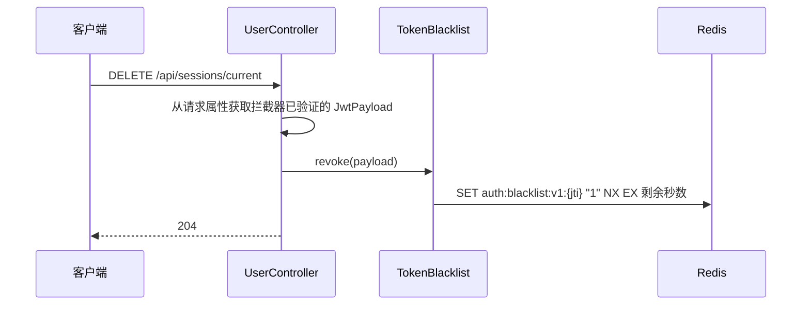
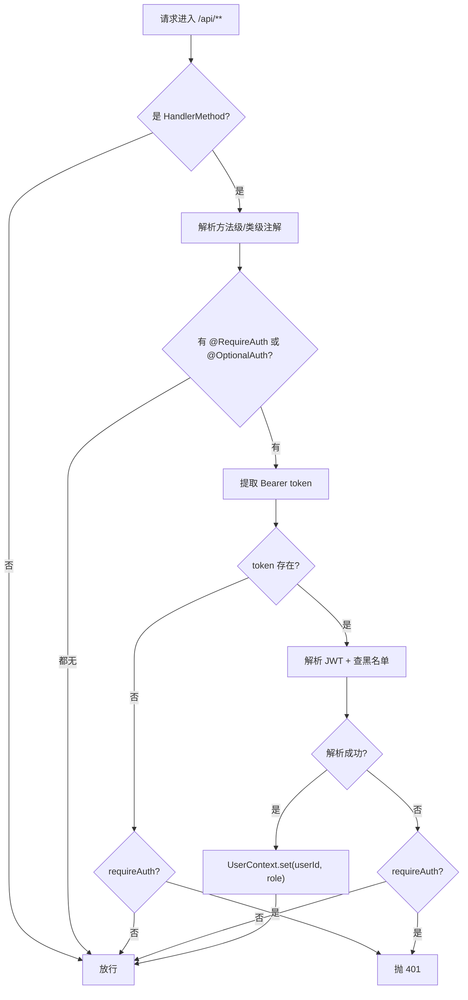
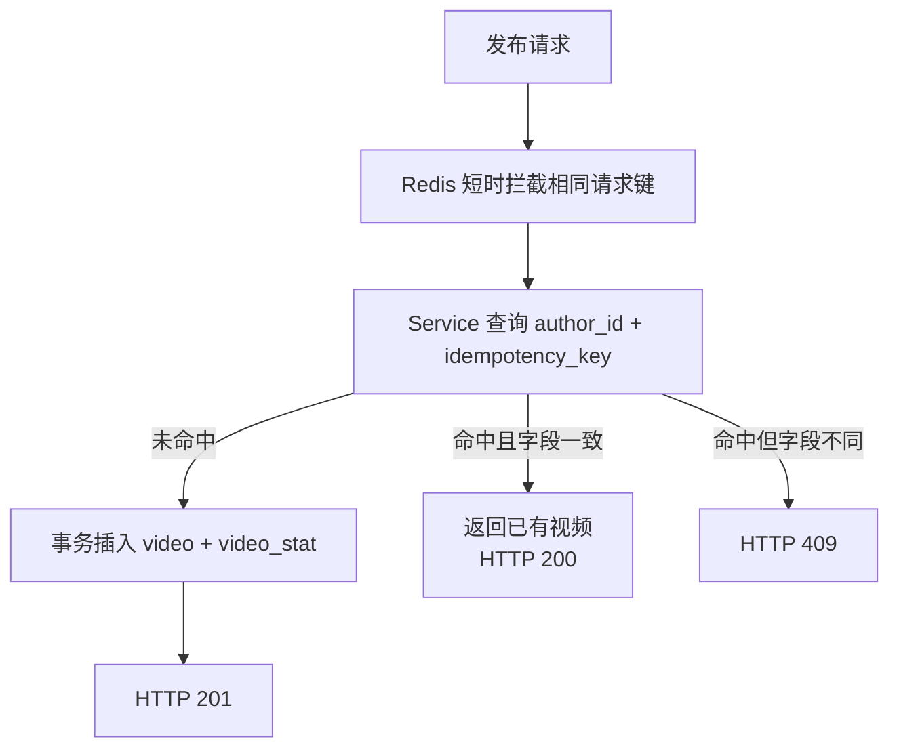

# 04 技术基础设施设计

本文描述全局公共组件的设计。**已实现的组件**在代码里可以直接找到，本文说明其职责与使用方式；**尚未实现的组件**给出设计方案，供后续按图施工。

## 1. 组件清单与实现状态

| 组件 | 类 / 位置 | 状态 |
| --- | --- | --- |
| 统一响应体 | `common/api/ApiResponse.java` | 已实现 |
| 全局错误码 | `common/api/ErrorCode.java` | 已实现 |
| 业务异常 | `common/exception/BusinessException.java` | 已实现 |
| 全局异常处理器 | `common/exception/GlobalExceptionHandler.java` | 已实现 |
| 用户上下文 | `common/context/UserContext.java` | 已实现 |
| 鉴权注解 | `common/annotation/RequireAuth.java` `OptionalAuth.java` | 已实现 |
| JWT 配置 / 载荷 / 工具 | `common/jwt/JwtProperties.java` `JwtPayload.java` `JwtUtil.java` | 已实现 |
| 令牌黑名单 | `common/jwt/TokenBlacklist.java` | 已实现 |
| JWT 鉴权拦截器 | `common/interceptor/JwtInterceptor.java` | 已实现 |
| 内部令牌拦截器 | `common/interceptor/InternalTokenInterceptor.java` | 待实现（设计见 §7） |
| 通用常量 | `common/constant/CommonConstant.java` | 已实现 |
| Redis 键常量 | `common/constant/RedisKeyConstant.java` | 已实现 |
| 认证装配 | `config/AuthenticationConfiguration.java` | 已实现（JWT、黑名单和密码编码器） |
| Web 配置 | `config/WebMvcConfiguration.java` | 已实现（鉴权拦截器、跨域和上传资源映射） |
| Redisson 配置 | `config/RedissonConfiguration.java` | 已实现 |
| MyBatis-Plus 配置 | `config/MybatisPlusConfiguration.java` + `application.yaml` | Mapper 扫描、分页、防误更新、时间填充和逻辑删除已启用 |
| 时间 / ID 游标编解码 | `common/pagination/TimeIdCursorCodec.java`、`TimeIdCursor.java` | 已实现，作品列表与 Timeline 共用（见 §8） |
| 请求幂等基础设施 | `common/annotation/Idempotent.java`、`common/idempotency/IdempotentAspect.java` | 已实现（Redis 短时重复提交拦截） |
| 限流切面 | `common/ratelimit/*` | 待实现（设计见 §10） |

---

## 2. 统一响应体

### 2.1 设计目标

原 Go 项目的响应体不统一：

- 中间件层 401 返回 `{"message": "..."}`
- 业务层 400/500 返回 `{"error": "..."}`
- 成功响应直接返回裸业务对象，没有包装

这导致前端要写多套判断分支（先试 `data.error`，再试 `data.message`）。本版本统一为一种结构。

### 2.2 结构定义

```java
public class ApiResponse<T> {
    private int code;        // 业务码，0 成功
    private String message;  // 提示信息
    private T data;          // 业务数据
}
```

### 2.3 工厂方法

```java
// 成功
ApiResponse.success()                        // code=0, message="ok", data=null
ApiResponse.success(data)                    // 携带数据
ApiResponse.success(data, "操作成功")         // 自定义提示语

// 失败
ApiResponse.error()                          // 默认 50000
ApiResponse.error(ErrorCode.VIDEO_NOT_FOUND) // 用错误码的默认文案
ApiResponse.error(ErrorCode.PARAM_ERROR, "标题不能为空")  // 覆盖文案
ApiResponse.error(90001, "自定义错误")        // 完全自定义
```

### 2.4 使用约定

**Controller 层统一返回 `ApiResponse<T>`**：

```java
@GetMapping("/{videoId}")
public ApiResponse<VideoVO> get(@PathVariable Long videoId) {
    return ApiResponse.success(videoService.get(videoId));
}
```

**契约返回值用 `ApiResponse<Void>`**：

```java
@DeleteMapping("/{videoId}")
public ApiResponse<Void> delete(@PathVariable Long videoId) {
    videoService.delete(UserContext.requireUserId(), videoId);
    return ApiResponse.success();
}
```

**不要吞掉 `data`**：`ApiResponse.success(null)` 会返回 `data: null`，这是合法响应；但业务失败请用 `error(...)` 而不是 `success(null)`，否则前端无法区分。

### 2.5 HTTP 状态码与业务码的关系

两者同时保持语义：

| 层次 | 作用 |
| --- | --- |
| HTTP 状态码 | 网关限流、监控告警、日志统计按它分类；前端用它做通用分支（401 跳登录） |
| 业务 `code` | 前端做精确分支（如「账号已存在」提示重新输入账号） |

**成功场景的状态码**：

| 场景 | HTTP 状态码 |
| --- | --- |
| 查询 / 更新 | 200 |
| 创建成功 | 201 |
| 幂等重放返回已有资源 | 200（区分「本次没有新建」） |
| 删除成功、登出 | 204 |

用 `200` 表示幂等重放是原项目的做法，保留。前端如果只关心「操作是否成功」，判断 `code == 0` 即可，不必区分 200/201。

---

## 3. 全局错误码

### 3.1 编码规则

`业务模块(2位) + 序号(3位)`，共 5 位。

| 前缀 | 模块 |
| --- | --- |
| `00` | 通用 |
| `10` | 账号 |
| `20` | 视频 |
| `30` | 互动 |
| `40` | 关系 |
| `50` | 消息 |
| `60` | 播放优化 |
| `70` | Feed / 推荐 / 曝光 |
| `80` | 幂等 / 限流 |
| `90` | 上传 |

`SUCCESS` 固定为 `0`。

### 3.2 枚举定义

```java
public enum ErrorCode {
    SUCCESS(0, "ok", 200),
    PARAM_ERROR(40000, "invalid request", 400),
    UNAUTHORIZED(40100, "unauthorized", 401),
    VIDEO_NOT_FOUND(20008, "video not found", 404),
    // ...
}
```

三个属性：

| 属性 | 说明 |
| --- | --- |
| `code` | 业务码，对外暴露 |
| `message` | 默认提示语，**英文短句** |
| `httpStatus` | 默认映射的 HTTP 状态码 |

### 3.3 为什么 message 用英文

原 Go 项目的错误文案就是英文（`"video not found"`），且前端有中文兜底文案：

```js
setMessage(error.message || "登录失败，请检查账号与密码");
```

保留英文有两个好处：

1. 与 Go 版语义一致，便于对照排查。
2. 错误码是稳定的机器接口，文案是展示细节。真要本地化，应该由前端按 `code` 映射中文，而不是让后端返回中文字符串（后端无法知道用户的语言偏好）。

### 3.4 新增错误码的流程

1. 在 `ErrorCode` 对应模块段落追加枚举项，序号递增。
2. 如果该错误的 HTTP 状态码不是 400，显式传入第三个参数。
3. 在文档 `03-接口设计.md` 的错误码速查表补充（若属于高频错误）。

---

## 4. 全局异常处理

### 4.1 处理的异常类型

`GlobalExceptionHandler` 用 `@RestControllerAdvice` 统一捕获：

| 异常 | HTTP | code | 处理方式 |
| --- | --- | --- | --- |
| `BusinessException` | 取错误码定义 | 取错误码 | `warn` 日志，不打印堆栈 |
| `MethodArgumentNotValidException` | 400 | 40000 | 拼接所有字段错误为 `field: message; field2: message2` |
| `BindException` | 400 | 40000 | 同上（表单绑定场景） |
| `ConstraintViolationException` | 400 | 40000 | 方法参数级校验（`@RequestParam` 上的约束） |
| `HttpMessageNotReadableException` | 400 | 40000 | 请求体缺失或 JSON 格式错误 |
| `MethodArgumentTypeMismatchException` | 400 | 40000 | 路径变量类型不匹配（如给 `Long` 传字母） |
| `MissingServletRequestParameterException` | 400 | 40000 | 缺少必填查询参数 |
| `MaxUploadSizeExceededException` | 400 | 90005 | 上传超限 |
| `HttpRequestMethodNotSupportedException` | 405 | 40500 | 请求方法不支持 |
| `NoResourceFoundException` | 404 | 40400 | 路由不存在（不落到兜底 500） |
| `Exception` | 500 | 50000 | `error` 日志 + 完整堆栈 |

### 4.2 日志策略

| 类型 | 级别 | 是否打堆栈 | 理由 |
| --- | --- | --- | --- |
| 业务异常 | `warn` | 否 | 属于可预期的流程分支（用户输错密码），打堆栈会淹没真正的故障日志 |
| 参数校验失败 | `warn` | 否 | 同上 |
| 资源不存在 | `warn` | 否 | 同上 |
| 未预期异常 | `error` | 是 | 必须能定位，否则线上问题无法排查 |

### 4.3 兜底分支的信息安全

兜底分支对外**只返回通用文案** `internal server error`，不返回异常消息：

```java
log.error("未预期异常 uri={}", request.getRequestURI(), ex);
return build(ErrorCode.INTERNAL_ERROR, ErrorCode.INTERNAL_ERROR.getMessage());
```

如果直接把 `ex.getMessage()` 返回给前端，可能泄漏 SQL 语句、文件路径、类名等内部信息。

### 4.4 业务异常的抛出位置

```java
// Service 层抛业务异常
if (!video.getAuthorId().equals(userId)) {
    throw new BusinessException(ErrorCode.VIDEO_PERMISSION_DENIED);
}

// 需要更具体的文案时覆盖默认值
throw new BusinessException(ErrorCode.COMMENT_PERMISSION_DENIED, "只能删除自己的评论或自己视频下的评论");
```

**不要在 Controller 层写 try-catch**：全局处理器已经覆盖，业务异常直接往上抛即可。

---

## 5. JWT 认证

### 5.1 令牌结构

HS256 对称签名，声明结构与 Go 版一致：

| 声明 | 含义 |
| --- | --- |
| `uid` | 用户 ID |
| `role` | 用户角色 |
| `token_type` | 固定 `access` |
| `jti` | 令牌唯一标识（16 字节随机 hex） |
| `iat` / `exp` | 签发 / 过期时间 |
| `iss` | 签发者 |
| `sub` | 用户 ID 字符串（JWT 标准字段，与 `uid` 冗余） |

保留 `token_type` 是为了将来可能的 refresh token 机制：校验时比对类型，refresh token 无法当作 access token 使用。

### 5.2 签名与校验

```java
// 签发
String token = jwtUtil.signAccessToken(userId, role);

// 校验
JwtPayload payload = jwtUtil.parseAccessToken(token);
```

**安全约束**

| 约束 | 实现 |
| --- | --- |
| 算法限定 | 只接受 HS256，防止算法降级攻击 |
| 密钥长度 | 构造函数校验 >= 32 字节，不足则启动失败 |
| jti 随机性 | `SecureRandom` 生成 16 字节 |
| 异常信息 | 解析失败统一返回 `invalid access token`，不暴露底层原因 |

### 5.3 密钥管理

`application.yaml` 中的默认密钥仅用于开发：

```yaml
gcfeed:
  jwt:
    secret: ${GCFEED_JWT_SECRET:gcfeed-dev-only-secret-key-please-change-it-32bytes}
```

生产环境必须通过环境变量覆盖。启动时校验长度可以防止「忘了改配置就上线」这类事故。

### 5.4 登出与令牌吊销

JWT 本身无状态、无法吊销，因此引入 Redis 黑名单：



**设计要点**

1. **TTL = 令牌剩余有效期**：令牌自然过期后黑名单条目也过期，Redis 不会无限增长。
2. **Redis 不可用时拒绝受保护请求**：黑名单查询和写入的异常向上传播，返回统一服务端错误。黑名单是认证状态，不能当作可丢失的缓存，否则已经登出的令牌会重新可用。
3. **只在需要时查询**：拦截器在解析 token 成功后查一次黑名单，属于一次 Redis GET，开销可接受。

**黑名单键**：`auth:blacklist:v1:{jti}`

### 5.5 令牌载荷对象

`JwtPayload` 是业务侧依赖的对象，屏蔽 jjwt 的 `Claims`：

```java
public class JwtPayload {
    private final Long userId;
    private final String role;
    private final String tokenType;
    private final String jwtId;
    private final long issuedAt;
    private final long expiresAt;

    public long remainingSeconds();  // 用于设置黑名单 TTL
}
```

这样将来换 JWT 库或调整声明结构，改动范围局限在 `JwtUtil` 内部。

**数字类型处理**：jjwt 反序列化数字时可能得到 `Integer` 或 `Long`，`resolveUserId` 统一按 `Number` 取 `longValue()`，避免大 ID 溢出。

---

## 6. 鉴权拦截器

### 6.1 为什么用注解而不是路径匹配

原 Go 项目按路由组挂中间件：

```go
users.GET("/me", authMiddleware, accountHandler.Me)
users.GET("/:userId", accountHandler.Get)      // 同一个 /users 组，鉴权不同
```

用 Spring 的 `addPathPatterns` 很难表达这种差异：`/api/users/**` 会同时匹配 `/api/users/me`（需登录）与 `/api/users/42`（公开）。

注解驱动直接表达意图：

```java
@GetMapping("/me")
@RequireAuth
public ApiResponse<UserVO> me() { ... }

@GetMapping("/{userId}")
public ApiResponse<PublicUserVO> get(@PathVariable Long userId) { ... }   // 公开
```

### 6.2 拦截器执行流程



### 6.3 注解优先级

方法级注解优先于类级：

```java
@RestController
@RequestMapping("/api/videos")
@RequireAuth                                    // 整个 Controller 默认需要登录
public class VideoController {

    @GetMapping("/{videoId}")
    @OptionalAuth                               // 视频详情可匿名访问
    public ApiResponse<VideoVO> get(...) { ... }
}
```

### 6.4 上下文清理

`afterCompletion` 中调用 `UserContext.clear()`：

```java
@Override
public void afterCompletion(HttpServletRequest request, HttpServletResponse response,
                            Object handler, Exception ex) {
    UserContext.clear();
}
```

**这一步不能省**：Tomcat 用线程池处理请求，同一个线程会被复用。如果不清空，下一个请求可能读到上一个用户的身份，造成越权。

### 6.5 拦截器抛异常的处理

拦截器的 `preHandle` 抛出 `BusinessException` 时，Spring MVC 会把它交给 `HandlerExceptionResolver` 处理，因此 `@RestControllerAdvice` 能正常接管，不需要在拦截器里手写 JSON 输出。这是选择抛异常而非 `response.getWriter().write(...)` 的原因。

---

## 7. 内部接口鉴权（待实现）

### 7.1 现状问题

原 Go 项目中：

| 接口 | 鉴权状态 |
| --- | --- |
| `/internal/messages` | ✅ `X-Internal-Token` |
| `/internal/playback-qos-reports` | ✅ `X-Internal-Token` |
| `/internal/recommendation-candidates` | ❌ 无 |
| `/internal/exposure-decisions` | ❌ 无 |
| `/internal/exposures` | ❌ 无 |

后三个接口可以被任意调用者刷新推荐曝光数据，属于安全缺口。

### 7.2 设计方案

```java
public class InternalTokenInterceptor implements HandlerInterceptor {

    private final String expectedToken;

    @Override
    public boolean preHandle(HttpServletRequest request, HttpServletResponse response, Object handler) {
        String provided = request.getHeader(CommonConstant.INTERNAL_TOKEN_HEADER);
        if (provided == null || provided.isBlank()) {
            throw new BusinessException(ErrorCode.UNAUTHORIZED, "internal token is required");
        }
        // 常量时间比较，避免时序攻击
        boolean matched = MessageDigest.isEqual(
                provided.getBytes(StandardCharsets.UTF_8),
                expectedToken.getBytes(StandardCharsets.UTF_8));
        if (!matched) {
            throw new BusinessException(ErrorCode.UNAUTHORIZED, "invalid internal token");
        }
        return true;
    }
}
```

注册：

```java
registry.addInterceptor(new InternalTokenInterceptor(internalToken))
        .addPathPatterns("/internal/**");
```

### 7.3 常量时间比较的必要性

`String.equals` 在比较到第一个不同字符时就返回，攻击者可以据此逐字节猜出令牌。`MessageDigest.isEqual` 的实现是常量时间的（时间与内容无关）。原 Go 代码用了 `subtle.ConstantTimeCompare`，本版本保持一致。

---

## 8. 游标编解码（时间 / ID 双键已实现）

### 8.1 公共工具与模块适配

`common.pagination.TimeIdCursor` 承载 `LocalDateTime time` 和 `Long id`；`TimeIdCursorCodec` 统一编解码。

```java
public static String encode(TimeIdCursor cursor);
public static TimeIdCursor decode(String encoded);
```

作品列表的 `VideoCursorCodec` 保留为薄委托，将 `VideoCursor(publishedAt, videoId)` 转为公共类型。Feed 的 `FeedCursor` 通过同一工具转换，不重复实现 Base64 或时间解析。

### 8.2 当前编码格式与兼容性

```
LocalDateTime.toString() + "|" + ID → UTF-8 → Base64 URL-Safe（无 padding）
```

- 保持已发布的视频作品列表游标格式，本次不切换为 JSON，也不增加标准 Base64 解码分支。
- 时间使用完整精度，不能用面向展示的秒级时间字符串生成游标。
- 请求游标为 `null`、空串或空白时表示首页；其他解码失败、字段数错误、非法时间、ID 非正数或溢出均返回 `400 / 70002`，不能静默回到首页。
- Base64 只是编码，不是加密或签名；客户端将其视为不透明分页位置并原样回传。
- 下表中的多键、热榜窗口及其他模块游标仍为规划，不代表通用 JSON 编解码器已经实现。

### 8.3 各列表的游标内容

| 列表 | 游标字段 | 对应表列 |
| --- | --- | --- |
| Timeline / Following Feed | `published_at`, `video_id` | `video.published_at`, `video.id` |
| Hot Feed（仓储降级） | `hot_score`, `published_at`, `video_id` | 计算列, `video.published_at`, `video.id` |
| Hot Feed（Redis 窗口） | `window_end`, `offset` | — |
| 评论列表 | `created_at`, `comment_id` | `interaction_comment.created_at`, `id` |
| 消息列表 | `created_at`, `message_id` | `user_message.created_at`, `id` |
| 关注列表 | `followed_at`, `user_id` | `user_follow.updated_at`, `target_user_id` |
| 粉丝列表 | `followed_at`, `user_id` | `user_follow.updated_at`, `user_id` |
| 推荐候选 | `rank_score`, `published_at`, `video_id` | 计算列, `video.published_at`, `video.id` |

### 8.4 翻页条件

统一用「双键比较」或「三键比较」，与排序键严格对应：

```sql
-- 双键（timeline）
WHERE published_at < #{cursorPublishedAt}
   OR (published_at = #{cursorPublishedAt} AND id < #{cursorVideoId})

-- 三键（hot 仓储降级）
WHERE hot_score < #{cursorHotScore}
   OR (hot_score = #{cursorHotScore} AND published_at < #{cursorPublishedAt})
   OR (hot_score = #{cursorHotScore} AND published_at = #{cursorPublishedAt} AND id < #{cursorVideoId})
```

浮点数比较需要用容差（原 Go 用 `1e-9`），因为 `rank_score` 是算出来的 double，直接 `=` 比较不可靠。

### 8.5 空游标处理

- 请求游标为空 → 首页，不加翻页条件。
- 本页结果为空 → `next_cursor` 返回 `""`，`has_more = false`。
- 本页有结果 → 取**最后一条**的排序键编码为 `next_cursor`（即使 `has_more = false` 也返回，便于前端记录位置）。

---

## 9. 幂等设计（已实现范围与待实现扩展）

user 模块不接入通用幂等记录表：注册靠账号唯一约束，资料更新使用字段赋值，登出以 jti 去重。见 [05 模块功能设计 §1.6](05-模块功能设计.md#16-幂等取舍本次实现)。

### 9.1 三种幂等方案

不同接口适合不同方案，不要无脑用同一种。

| 方案 | 适用 | 已用于 |
| --- | --- | --- |
| **业务唯一约束** | 业务实体本身必须唯一 | 视频发布仍保留 `uk_author_idempotency` 作为数据约束；其他模块按各自业务约束处理 |
| **状态幂等** | 操作本身收敛到固定状态 | 点赞/收藏重复设置目标状态不重复修改计数 |
| **短时请求拦截** | 窗口内拒绝重复提交，不保存结果 | `@Idempotent` 用 Redis `SET NX` + 3 秒 TTL |

### 9.2 视频发布的业务去重



Redis 只处理 3 秒内的重复提交。长期去重依靠视频唯一索引及 Service 字段比较，不保存历史 HTTP 响应。

同作者并发使用相同键时，唯一索引只有一个事务可插入；另一事务查询已有记录并比对业务字段。

### 9.3 状态机方案

点赞和收藏靠「状态收敛到目标值 + 计数只在状态真正变化时增减」实现。Redis 的短时请求键只拦截重复提交：

| 请求 | 行不存在 | 行状态 = 目标状态 | 行状态 ≠ 目标状态 |
| --- | --- | --- | --- |
| PUT | 插入，计数 +1 | 不动，计数不变 | 更新，计数 +1 |
| DELETE | 插入取消态行，计数不变 | 不动，计数不变 | 更新，计数 -1 |

**并发安全**：当前实现先锁定公开视频，再锁行为行和统计行；固定锁顺序与视频删除一致，状态变化和计数更新在同一事务中完成。

### 9.4 `@Idempotent` 短时重复提交拦截（已实现）

`@Idempotent` 通过方法参数表达式声明固定 `scope`、用户 ID 和请求键。Redis 以 `SET NX` 原子写入带 3 秒 TTL 的占用标记。相同 scope、用户和键在窗口内重复提交返回 `409`；空键直接放行业务调用，业务失败会删除标记，成功标记保留至 TTL 到期。当前接入视频发布及点赞、取消点赞、收藏、取消收藏。

- 请求键去首尾空白，最长 128 个字符。错误或响应丢失后的重试可能在 3 秒内得到 409，窗口结束后重新执行。
- 组件不存参数指纹和响应快照，不提供结果重放或跨 Redis/数据库事务原子性。
- 视频长期去重由 `uk_author_idempotency` 与业务字段比对负责；互动长期正确性由唯一索引、视频行锁、状态转换和计数事务保证。

### 9.5 数据库迁移

本次轻量请求拦截不需要新增数据库表或迁移脚本。已有环境中历史遗留的 `idempotent_record` 表可以保留，不再读写；不要为移除它而重跑含 `DROP TABLE` 的完整 schema。

---

## 10. 限流设计（待实现）

### 10.1 为什么需要

原项目没有任何限流。以下接口容易被刷：

| 接口 | 风险 |
| --- | --- |
| `POST /api/videos/{id}/comments` | 刷评论 |
| `POST /api/videos/{id}/like` | 刷点赞（配合热榜刷分） |
| `POST /api/uploads` | 刷磁盘 |
| `POST /api/video-view-events` | 刷曝光流水，污染推荐特征 |
| `POST /api/sessions` | 撞库 |

### 10.2 方案：Redisson 令牌桶

Redisson 自带 `RRateLimiter`，无需自己实现 Lua 脚本：

```java
RRateLimiter limiter = redissonClient.getRateLimiter("ratelimit:v1:comment:" + userId);
limiter.trySetRate(RateType.OVERALL, 10, Duration.ofMinutes(1));   // 每分钟 10 次
limiter.expire(Duration.ofMinutes(5));

if (!limiter.tryAcquire()) {
    throw new BusinessException(ErrorCode.TOO_MANY_REQUESTS);
}
```

### 10.3 注解封装

```java
@Target(ElementType.METHOD)
@Retention(RetentionPolicy.RUNTIME)
public @interface RateLimit {
    /** 限流维度 */
    LimitDimension dimension() default LimitDimension.USER;

    /** 时间窗口内允许的次数 */
    int permits();

    /** 窗口长度（秒） */
    int windowSeconds();
}
```

```java
@RateLimit(dimension = LimitDimension.USER, permits = 10, windowSeconds = 60)
@PostMapping("/{videoId}/comments")
public ApiResponse<CommentVO> createComment(...) { ... }
```

**限流维度**

| 维度 | 键 | 适用 |
| --- | --- | --- |
| `USER` | `ratelimit:v1:{scope}:u:{userId}` | 登录后的写操作 |
| `IP` | `ratelimit:v1:{scope}:ip:{ip}` | 登录、注册（防撞库） |
| `GLOBAL` | `ratelimit:v1:{scope}:all` | 保护下游资源 |

### 10.4 降级原则

限流是保护手段，本身不应该成为单点故障：

- Redis 异常时**放行**并记 `warn` 日志，不要因为限流组件故障导致业务不可用。
- 限流阈值应该通过配置项管理，便于高峰期临时调整，不需要改代码重新发布。

---

## 11. 用户上下文

### 11.1 设计

`UserContext` 用 `ThreadLocal` 承载当前请求的用户身份：

```java
UserContext.set(userId, role);              // 拦截器写入
Long userId = UserContext.getUserId();      // 可能为 null（匿名）
Long userId = UserContext.requireUserId();  // 必须登录，否则抛异常
String role = UserContext.getRole();
boolean authed = UserContext.isAuthenticated();
UserContext.clear();                        // 请求结束时清理
```

### 11.2 使用方式

```java
@PostMapping
@RequireAuth
public ApiResponse<VideoVO> create(@Valid @RequestBody CreateVideoDTO dto) {
    // 有 @RequireAuth 保证，用 requireUserId 更简洁
    return ApiResponse.success(videoService.createPublished(UserContext.requireUserId(), dto));
}

@GetMapping("/{videoId}")
@OptionalAuth
public ApiResponse<VideoVO> get(@PathVariable Long videoId) {
    // 可选登录，用 getUserId 并允许 null
    return ApiResponse.success(videoService.get(videoId, UserContext.getUserId()));
}
```

### 11.3 注意事项

**不要在业务代码里开新线程访问 UserContext**：

```java
// 错误：异步线程里读到的是 null（ThreadLocal 不跨线程）
CompletableFuture.runAsync(() -> {
    Long userId = UserContext.getUserId();   // null
});

// 正确：提交任务前先把值取出来当参数传递
Long userId = UserContext.requireUserId();
CompletableFuture.runAsync(() -> doSomething(userId));
```

需要跨线程传递时，可以用 `InheritableThreadLocal` 或阿里的 `TransmittableThreadLocal`，但更推荐显式传参 —— 隐式的上下文传递会让代码更难理解。

---

## 12. Redis 使用规范

### 12.1 键命名

```
业务域:对象:v版本号:标识
```

示例：

| 键 | 说明 |
| --- | --- |
| `video:card:v1:103` | 视频卡片缓存 |
| `video:stat:v1:103` | 视频计数 JSON |
| `interaction:action:v1:42:103:LIKE` | 用户对视频的点赞状态 |
| `feed:page:v1:timeline:limit:10:first` | Feed 首页缓存 |
| `feed:hot:minute:v1:202605041200` | 热榜分钟桶 |
| `auth:blacklist:v1:{jti}` | 令牌黑名单 |

**版本号 `v1` 的作用**：当键的内容结构发生不兼容变更时，把版本号提到 `v2`，旧键自然过期淘汰，不需要写迁移脚本批量删除。这是低成本高收益的实践。

### 12.2 TTL 必须设置

所有键都通过 `RedisKeyConstant` 定义 TTL，禁止写入无过期时间的键。无 TTL 的键在业务下线后会永久占用内存，且很难判断哪些可以删。

唯一例外是登出黑名单 —— 它的 TTL 等于令牌剩余有效期，本身就是自限的。

### 12.3 TTL 抖动

缓存集中过期会造成瞬时回源压力（缓存雪崩）。Feed 页缓存的 TTL 加 10%~20% 的随机抖动：

```java
public static Duration withJitter(Duration baseTtl, String cacheKey) {
    int jitterPercent = 10 + Math.abs(cacheKey.hashCode() % 11);   // 10~20
    return baseTtl.plusMillis(baseTtl.toMillis() * jitterPercent / 100);
}
```

抖动系数由缓存键的哈希决定，因此**同一个键每次算出的 TTL 固定**，不会出现「同一个键每次写入 TTL 都不同」导致难以排查的情况。

### 12.4 客户端选型

统一使用 **Redisson**，不再引入第二套 Redis 客户端：

| 能力 | Redisson API |
| --- | --- |
| 简单 KV | `getBucket(key)` |
| Hash | `getMap(key)` |
| 有序集合（热榜） | `getScoredSortedSet(key)` |
| 分布式锁 | `getLock(key)` |
| 限流器 | `getRateLimiter(key)` |
| 批量读写 | `getKeys().getBuckets()` |

原 Go 项目用 `go-redis`，其中热榜的 `ZUNIONSTORE`、计数分片读取等操作用了 Pipeline。Redisson 也支持批量操作（`RBatch`），语义可以对应。

**Redisson 的连接策略**：`RedissonConfiguration` 显式设置 `setLazyInitialization(true)`，首次访问 Redis 时建连，因此本地未启动 Redis 也能启动和注册。访问受保护接口和登出仍需要 Redis 可用。

---

## 13. MyBatis-Plus 配置

### 13.1 插件链

```java
MybatisPlusInterceptor interceptor = new MybatisPlusInterceptor();
interceptor.addInnerInterceptor(new BlockAttackInnerInterceptor());      // 先加
interceptor.addInnerInterceptor(new PaginationInnerInterceptor(DbType.MYSQL));  // 后加
```

**顺序有要求**：分页插件必须最后注册，否则与其他插件组合时可能失效。

`BlockAttackInnerInterceptor` 拦截没有 `WHERE` 条件的 UPDATE / DELETE，属于低成本高收益的防护 —— 能挡住「误执行全表更新」这类事故。

### 13.2 自动填充

`MetaObjectHandler` 自动填充时间字段：

| 操作 | 填充字段 |
| --- | --- |
| INSERT | `createdAt`（若未显式赋值）、`updatedAt` |
| UPDATE | `updatedAt` |

使用 `strictInsertFill` / `strictUpdateFill`，`createdAt` 标注 `@TableField(fill = FieldFill.INSERT)`，`updatedAt` 标注 `@TableField(fill = FieldFill.INSERT_UPDATE)`，只填充已声明填充策略且当前为空的字段。

### 13.3 逻辑删除

已通过 `application.yaml` 全局配置：

```yaml
mybatis-plus:
  global-config:
    db-config:
      logic-delete-field: deleted
      logic-delete-value: 1
      logic-not-delete-value: 0
```

效果：

- 所有 `selectById` / `selectList` 自动追加 `deleted = 0`。
- `deleteById` 自动改写为 `UPDATE ... SET deleted = 1`。
- 原生 SQL（`@Select` 手写）**不会**自动追加条件，需要在 SQL 里自己写 `AND deleted = 0`。这是最容易踩的坑。

### 13.4 Mapper 组织

| 场景 | 方式 |
| --- | --- |
| 单表 CRUD | `extends BaseMapper<T>`，不写 SQL |
| 简单条件查询 | `LambdaQueryWrapper` |
| 多表查询 | 优先由 Repository 分别调用 `BaseMapper` 并在 Java 中组装；确有性能需要时再使用 `@Select` |
| 批量写入 | 自定义 `insertBatch` SQL（MyBatis-Plus 的 `saveBatch` 也是循环插入，大批量时不适用） |

当前 Timeline 的双键条件、分页和批量查询全部由 `FeedRepositoryImpl` 使用 `LambdaQueryWrapper` + `BaseMapper` 完成，不需要手写 SQL 或 Mapper XML。`Page<>(1, limit + 1, false)` 只提供行数限制，关闭 count，续页由游标条件推进。

后续热榜计算或多表 JOIN 确有需要时可评估注解 SQL；不能为了尚未实现的场景提前加入 XML。

---

## 14. 配置项汇总

### 14.1 框架配置

| 配置键 | 值 | 说明 |
| --- | --- | --- |
| `spring.datasource.url` | `jdbc:mysql://localhost:3306/gcfeed?...` | 数据库连接 |
| `spring.datasource.username` | `root` | — |
| `spring.datasource.password` | `password@mysql` | — |
| `spring.data.redis.host` | `${CR_REDIS_HOST:localhost}` | 注意环境变量前缀是 `CR_` |
| `spring.data.redis.port` | `${CR_REDIS_PORT:6379}` | — |
| `spring.servlet.multipart.max-file-size` | `1024MB` | 与 nginx 的 `client_max_body_size` 对齐 |
| `spring.servlet.multipart.max-request-size` | `1024MB` | — |

### 14.2 业务配置

| 配置键 | 默认值 | 说明 |
| --- | --- | --- |
| `gcfeed.jwt.secret` | 开发弱密钥 | 生产必须用 `GCFEED_JWT_SECRET` 覆盖 |
| `gcfeed.jwt.access-ttl-seconds` | `900` | 15 分钟 |
| `gcfeed.jwt.issuer` | `gcfeed` | — |
| `gcfeed.internal.token` | 开发弱令牌 | 生产必须用 `GCFEED_INTERNAL_TOKEN` 覆盖 |
| `gcfeed.upload.root` | `./uploads` | 上传文件根目录 |

### 14.3 监控配置

| 配置键 | 值 |
| --- | --- |
| `management.endpoints.web.exposure.include` | `health,info,prometheus` |
| `management.metrics.tags.application` | `GCFeed` |

只暴露必要的端点，避免把 `/actuator/env`（含配置明文）、`/actuator/heapdump`（可下载堆内存）等敏感端点开放出去。
