# 05 模块功能设计

本文按模块说明职责、业务规则、事务边界与并发处理。接口的请求/响应字段见 [03 接口设计](03-接口设计.md)。

## 模块总览

| 领域 | 模块 | 职责 | 实现优先级 |
| --- | --- | --- | --- |
| 用户 | `user` | 注册、登录、登出、资料读写 | P0 |
| 用户 | `relation` | 关注、取关、关注/粉丝列表 | P0 |
| 内容 | `video` | 发布、详情、作品列表、删除 | P0 |
| 内容 | `interaction` | 点赞、收藏、评论 | P0 |
| 内容 | `upload` | 文件上传与校验 | P0 |
| 分发 | `feed` | 多场景 Feed 分页与卡片组装 | P0 |
| 分发 | `embedding` | 视频内容向量生成与补偿 | P1（已实现） |
| 分发 | `recommendation` | 召回、排序、打散 | P1 |
| 分发 | `exposure` | 观看行为上报、曝光聚合 | P1 |
| 体验 | `message` | 站内通知 | P1 |
| 体验 | `playback` | 播放参数、预加载、QoS | P1 |
| 治理 | `review` | 内容审核 | P2（规划） |
| 治理 | `admin` | 后台运营 | P2（规划） |
| 稳定性 | `governance` | 限流、降级、死信 | P2（规划） |
| 稳定性 | `monitoring` | 指标与告警 | P2（规划） |

---

## 1. user 账户模块

### 1.1 职责

提供身份能力：注册、登录（签发令牌）、登出（吊销令牌）、当前用户资料读写、公开资料查询。

### 1.2 类设计

```text
modules/user/
├── controller/UserController.java        # 6 个接口
├── service/UserService.java
├── service/impl/UserServiceImpl.java
├── mapper/UserMapper.java
├── entity/User.java
├── dto/RegisterDTO.java
├── dto/LoginDTO.java
├── dto/UpdateProfileDTO.java
└── vo/UserVO.java
    vo/PublicUserVO.java
    vo/LoginVO.java
```

### 1.3 业务规则

**注册**

| 规则 | 说明 |
| --- | --- |
| 账号唯一 | 靠 `uk_account` 唯一索引保证；冲突时返回 `409` |
| 账号格式 | 去空格后非空，长度 1..64 |
| 密码 | 去空格后非空，最长 64 字符且 UTF-8 不超过 72 字节；**只存 BCrypt 哈希** |
| 昵称 | 去空格后非空，长度 1..64 |
| 初始状态 | `status = 1`、`role = user`、`avatar_url` / `bio` 为空 |
| 初始化统计行 | 同时插入 `user_relation_stat`（`following_count = 0`、`follower_count = 0`） |
| 重复提交 | 不使用通用幂等键；`uk_account` 保证只创建一条账号，重复注册返回 409 |

**密码处理**

```java
String hash = passwordEncoder.encode(rawPassword);  // BCrypt，强度 10
boolean matches = passwordEncoder.matches(rawPassword, hash);
```

BCrypt 每次加密会生成随机盐，因此**同一个密码两次加密结果不同**，这是正确的（防止彩虹表）。校验只能用 `matches`，不能比较字符串。

**登录**

| 规则 | 说明 |
| --- | --- |
| 账号不存在 | 转成「凭证错误」返回，避免账号枚举 |
| 密码错误 | 返回 `401` / `code = 10012` |
| 账号非正常 | `status != 1` 返回 `403` / `code = 10013` |
| 令牌内容 | `uid` + `role`，有效期 900 秒 |

**账号枚举防护的实现**：

```java
User user = userMapper.selectByAccount(account);
if (user == null) {
    // 不能直接返回「用户不存在」，否则攻击者可以枚举出哪些账号已注册
    throw new BusinessException(ErrorCode.INVALID_CREDENTIALS);
}
if (!passwordEncoder.matches(password, user.getPassword())) {
    throw new BusinessException(ErrorCode.INVALID_CREDENTIALS);   // 与上一分支同一个错误
}
```

**当前实现**：账号不存在时也对一个启动时生成的假哈希执行一次 BCrypt 校验，减少与「账号存在但密码错」之间的耗时差异。错误响应始终一致；这只能缩小时间差异，不能保证网络层的绝对恒时。

**资料更新**

部分更新语义，靠 DTO 字段为 `null` 表示「未传」：

```java
public class UpdateProfileDTO {
    private String nickname;    // null 表示不改
    private String avatarUrl;
    private String bio;
}
```

| 规则 | 说明 |
| --- | --- |
| 全字段为 null | 返回 `400` / `code = 10009` |
| `nickname` 传空串 | 返回 `400`（昵称不能清空） |
| `avatar_url` / `bio` 传空串 | 允许（表示清空该字段） |
| 只能改三个字段 | 账号、密码、角色、状态不在此接口修改 |

**为什么用包装类型而不是基本类型**：如果 `nickname` 用 `String` 且带默认值，就无法区分「字段没传」和「传了空值」。包装类型的 `null` 天然表达「未传」。

### 1.4 事务边界

| 操作 | 事务 |
| --- | --- |
| 注册 | `@Transactional`：插入 `account` + 插入 `user_relation_stat` |
| 登录 | 只读，不加事务 |
| 资料更新 | `@Transactional`（单表，但保持一致性语义） |

### 1.5 并发处理

**注册并发**：两个请求同时注册同一个账号。

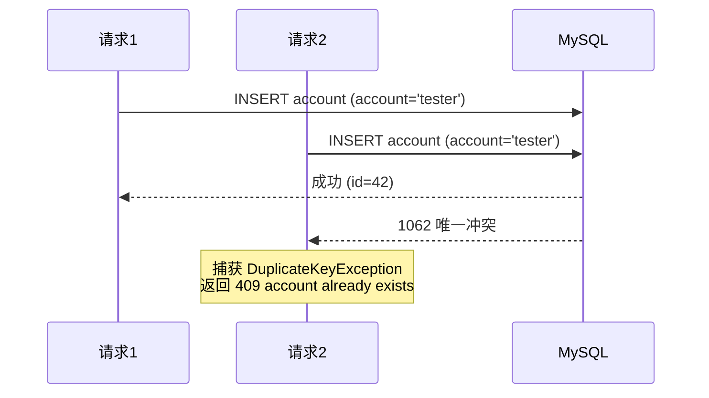

不需要先查后插，直接插入靠唯一索引兜住。**先查后插在并发下不可靠**：两个请求都会查到「不存在」，然后都尝试插入。

**资料并发更新**：使用只含请求非 null 字段的新实体执行 `updateById`，不把查询到的完整旧实体写回。
例如一个请求改昵称、另一个改简介，两个更新不会覆盖对方未涉及的字段。
同一字段采用最后写入生效；当前没有版本冲突检测，也不缓存第一次 PATCH 响应。

### 1.6 幂等取舍（本次实现）

本模块不接入 `Idempotency-Key`、幂等记录表或分布式锁。

- 注册由唯一索引防重复创建，但不是“重复请求重放第一次成功响应”：成功返回 201，重试撞账号返回 409。
- GET 无写入副作用；登录每次签发新 jti，不缓存复用令牌。
- PATCH 对显式传入的字段赋值，连续重复提交收敛到相同资料；不支持增量计数等操作。
- 登出以 jti 为键执行 Redis `SET NX` 并设置剩余 TTL。首次返回 204，此后同一 token 被鉴权拒绝，返回 401；最终状态仍为已吊销。
- 后续如果注册引入发券、发送欢迎消息等副作用，应分别设计事务内去重或事件消费幂等，再评估是否需要请求级重放。

实现与验证说明见 [09 用户模块实现](impl/00-用户模块实现.md)。


---

## 2. relation 关系模块

### 2.1 职责

关注关系与关系统计。

### 2.2 业务规则

| 规则 | 说明 |
| --- | --- |
| 关注目标必须存在且正常 | 目标用户不存在或 `status != 1` → `404` / `code = 40003` |
| 禁止关注自己 | `user_id == target_user_id` → `400` / `code = 40002` |
| 关系软状态 | 取关只改 `status = 2`，不物理删除 |
| 幂等 | 可选请求键仅在 3 秒内拦截重复提交并返回 409；请求键过期后按当前状态处理，状态变化时才更新计数 |

### 2.3 核心流程

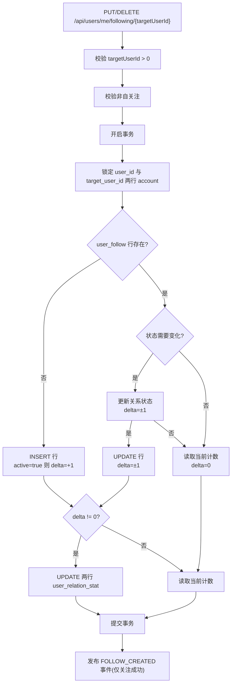

### 2.4 死锁防范

关注操作需要更新**两行** `user_relation_stat`（关注者的 `following_count`、被关注者的 `follower_count`）。如果并发场景下加锁顺序不一致，会产生死锁：

```text
请求1: A 关注 B → 锁 A 的统计行 → 等 B 的统计行
请求2: B 关注 A → 锁 B 的统计行 → 等 A 的统计行
                  ↑ 死锁
```

**解决方案：按 `user_id` 升序加锁。**

```java
Long firstId = Math.min(userId, targetUserId);
Long secondId = Math.max(userId, targetUserId);

// 固定顺序：先小 ID 再大 ID
lockUserStat(firstId);
lockUserStat(secondId);
```

这样无论谁先发起，加锁顺序都是一致的，不会形成循环等待。

同样的规则适用于 `account` 行的锁定（校验用户是否存在时）。

### 2.5 事务边界

关注/取关是**跨两张表四个行**的操作（`user_follow` 一行 + `user_relation_stat` 两行 + `account` 两行锁），必须在单个事务内。

```java
@Transactional(rollbackFor = Exception.class)
public FollowVO setFollow(Long userId, Long targetUserId, boolean active, String idempotencyKey) {
    // ...
}
```

`rollbackFor = Exception.class` 是必要的：Spring 默认只对 `RuntimeException` 回滚，受检异常不回滚。显式声明可以避免遗漏。

### 2.6 计数更新语句

```sql
-- 关注：关注者 following_count + 1
UPDATE user_relation_stat
SET following_count = following_count + 1, updated_at = NOW()
WHERE user_id = #{userId}

-- 关注：被关注者 follower_count + 1
UPDATE user_relation_stat
SET follower_count = follower_count + 1, updated_at = NOW()
WHERE user_id = #{targetUserId}
```

取关时如果计数可能变成负数，用 `GREATEST` 钳制。虽然逻辑上不会（计数与状态变化一一对应），但线上数据可能有历史脏数据，钳制是廉价的安全网。

### 2.7 列表查询

**关注列表**

```sql
SELECT f.target_user_id AS user_id, a.nickname, a.avatar_url, a.bio, f.updated_at AS followed_at
FROM user_follow f
JOIN account a ON a.id = f.target_user_id AND a.status <> 3
WHERE f.user_id = #{userId}
  AND f.status = 1
  AND (f.updated_at < #{cursorFollowedAt}
       OR (f.updated_at = #{cursorFollowedAt} AND f.target_user_id < #{cursorUserId}))
ORDER BY f.updated_at DESC, f.target_user_id DESC
LIMIT #{limit + 1}
```

走 `idx_user_status_updated (user_id, status, updated_at, target_user_id)`，游标条件与索引列顺序完全对应，是范围扫描而不是 filesort。

**粉丝列表**：把 `target_user_id` 的过滤换成 `user_id`，排序键换成 `user_id`，走 `idx_target_status_updated`。

### 2.8 关注流回填（后续规划）

当前关注流直接查询有效关系与视频，无需收件箱回填；关系实际变化处仅保留 RabbitMQ TODO，尚未发布关注通知。

新关注一个作者时，应该能看到他最近的作品。这属于 Feed 模块的能力，但由关系模块触发：

| 作者粉丝数 | 处理 |
| --- | --- |
| < 10000（普通作者） | 回填该作者最近 100 条视频到新粉丝的收件箱 |
| >= 10000（大 V） | 不回填，改由 Feed 读时拉取（见 Feed 章节） |

"尽力而为"语义：回填失败不影响关注接口的成功返回，只记日志。

---

## 3. video 视频模块

### 3.1 职责

视频的发布、详情、作品列表、软删除，以及计数增量缓冲与刷库任务（`VideoStatDeltaBuffer`、`VideoStatFlushJob`）。**不决定计数怎么变** —— 增量由 `interaction` 模块在事务提交后产生，本模块只负责合并写回 `video_stat`。

### 3.2 业务规则

**发布**

| 规则 | 说明 |
| --- | --- |
| 标题 | 去空格后非空，<= 128 |
| 简介 | 可选，<= 512 |
| 视频地址 | 非空，<= 512 |
| 封面地址 | 非空，<= 512 |
| 创建即发布 | 直接 `status = 2` 并写 `published_at = now()` |
| 幂等 | `uk_author_idempotency (author_id, idempotency_key)` |

**删除**

| 规则 | 说明 |
| --- | --- |
| 作者鉴权 | 只有 `author_id == 当前用户` 才能删；否则 `403` |
| 软删除 | `status = 4`，行保留 |
| 幂等 | 已删除的视频重复删除返回成功 |

**作品列表**

| 接口 | 状态过滤 |
| --- | --- |
| `GET /api/users/me/videos` | `status IN (2, 3)` —— 下架的视频作者自己能看到 |
| `GET /api/users/{userId}/videos` | `status = 2` —— 公开只看到上线的 |

**详情**

只返回 `status = 2` 的视频。作者本人通过详情接口也看不到自己的下架视频（列表接口能看到），这是原项目的实现，保持一致。

### 3.3 事务边界

发布的 `video` 和 `video_stat` 必须一起提交。`@Idempotent` 只在 Redis 做 3 秒短时重复提交拦截，不参与业务事务，也不保存响应快照。

### 3.4 请求拦截与业务去重

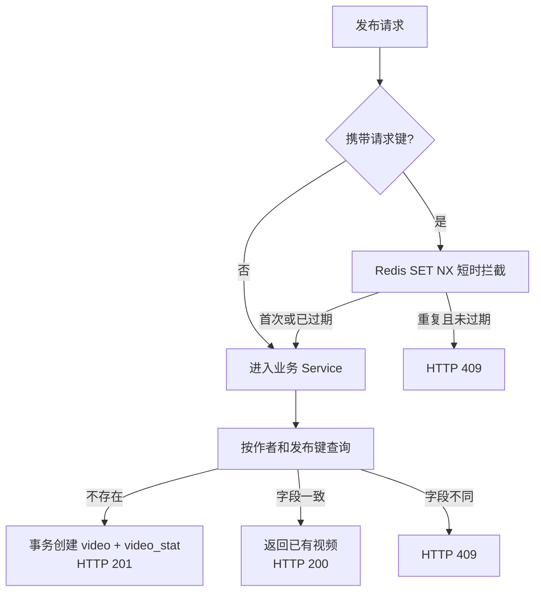

`video` 表通过 `uk_author_idempotency` 保证同一作者同一发布键只创建一个视频。再次提交时比较标题、简介、媒体地址和封面地址；一致则返回已有视频，不一致返回 `409`。首次创建返回 `201`，已有视频返回 `200`。空键跳过 Redis 拦截；键去首尾空白后最长 128 个字符。短时拦截不保存响应，窗口外由业务唯一约束保护。

### 3.5 详情查询

```sql
SELECT v.id, v.author_id, v.title, v.description, v.media_url, v.cover_url,
       v.status, v.published_at, v.created_at, v.updated_at,
       COALESCE(vs.like_count, 0) AS like_count,
       COALESCE(vs.comment_count, 0) AS comment_count,
       COALESCE(vs.favorite_count, 0) AS favorite_count
FROM video v
LEFT JOIN video_stat vs ON vs.video_id = v.id
WHERE v.id = #{videoId}
  AND v.status = 2
```

用 `LEFT JOIN` + `COALESCE` 而不是 `INNER JOIN`：如果 `video_stat` 行缺失（历史数据），`INNER JOIN` 会导致视频查不出来，而 `LEFT JOIN` 会把计数当 0 处理。原 Go 代码也用了 `LEFT JOIN`。

---

## 4. interaction 互动模块

这是并发最密集的模块，也是设计最需要小心的地方。

### 4.1 职责

点赞、收藏、评论的事实记录，以及点赞/收藏计数的增量产生与对账。

**一致性约定**：`interaction_action` 是事实来源，**强一致**；`video_stat.like_count / favorite_count` 是派生计数，**最终一致**（正常情况下落后一个刷库周期，默认 2 秒）。

**边界**：计数的变化只由本模块产生（提交后记入增量缓冲），由 `video` 模块的 `VideoStatFlushJob` 合并写回；本模块的 `InteractionStatReconcileJob` 负责按事实表校正。Feed、视频详情只读 `video_stat` 的已刷库值。

### 4.2 点赞/收藏的状态机

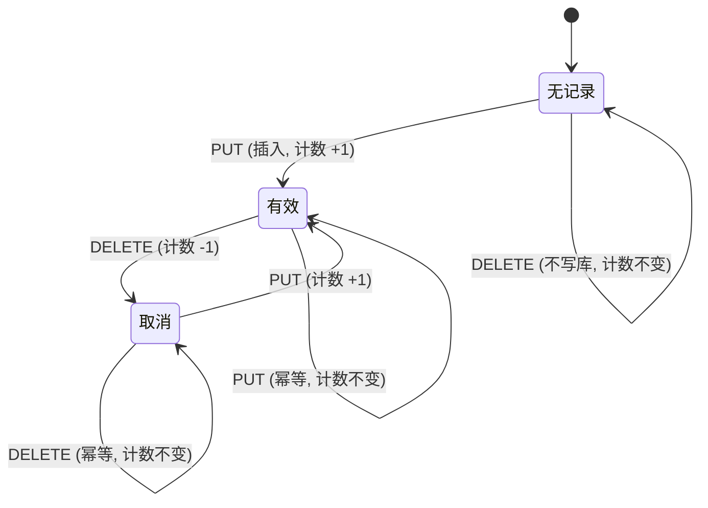

首次 DELETE 不再补建取消态行：没有记录和取消态对外表现一致，补建只会多一次写入和一次唯一键竞争。

### 4.3 并发安全实现

**问题**：两个并发的点赞请求同时到达，「先读状态再写」会重复计数。

```
时刻  T1              T2
      ─────────────────────────────
      读 action 行 → 不存在
                      读 action 行 → 不存在
      插入（计数 +1）
                      插入（计数 +1）  ← 重复计数！
```

**当前实现不加任何显式锁**，用「条件更新的影响行数」和「唯一键」判定本次请求是否真的改变了状态：

```text
PUT（activate）:
1. 校验视频已发布（普通读）；已删除、下架或不存在返回 404。
2. UPDATE interaction_action SET status = 1 WHERE 用户+视频+类型 AND status = 2
   影响 1 行 → 状态变化，delta = +1
3. 否则 INSERT 有效行
   成功 → 状态变化，delta = +1
   DuplicateKeyException → 行已是有效态（或被并发请求抢先），delta = 0

DELETE（cancel）:
1. 同上校验视频。
2. UPDATE ... SET status = 2 WHERE ... AND status = 1
   影响 1 行 → delta = -1；否则 delta = 0
```

同一行上的并发条件更新由 InnoDB 行锁天然串行，只有一个请求能看到 `status = from` 并改成功；并发插入由 `uk_user_video_action` 只放行一个。行锁只在这一条语句内持有到事务结束，事务里不再有其他写，所以持锁时间很短，不同用户之间也不互相阻塞。

**隔离级别用 READ COMMITTED**：REPEATABLE READ 下，对不存在的行做条件 UPDATE 会加间隙锁，两个用户同时首次点赞同一视频时，间隙锁 + 插入意向锁会互相等待形成死锁。RC 不加间隙锁，唯一键检查仍然生效。

**与视频删除的竞态**：校验视频状态是普通读，删除与点赞并发时可能在视频刚删除后多写一条互动。它只影响已删除视频的计数，而已删除视频不再展示，所以接受这个窗口，不用视频行锁串行化。

### 4.4 计数：增量缓冲、定时刷库与对账

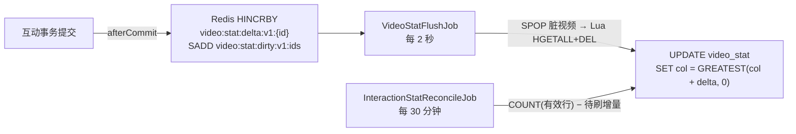

| 环节 | 做法 | 失败时 |
| --- | --- | --- |
| 记录增量 | 事务提交后执行 Lua：`HINCRBY` + `SADD` 脏集合，两个键都带 24 小时 TTL | 只记 warn 日志，互动本身已成功；漏掉的增量由对账纠正 |
| 刷库 | `SPOP` 取一批脏视频（多实例天然分片），Lua 原子取出并删除增量，合并成一条 `UPDATE` | 写库异常时把增量加回缓冲，下一轮重试；`video_stat` 行不存在时丢弃并告警 |
| 对账 | 按 `video_id` 游标分批，目标值 = `COUNT(status = 1)` − 尚未刷库的增量，和库里不同才覆盖 | 下一轮继续；正在变化的视频可能短暂偏差 ±1，下一轮收敛 |

刷库语句仍是原子自增，不要写成「先 SELECT 读计数，再 UPDATE 写回」：

```sql
UPDATE video_stat
SET like_count = GREATEST(like_count + #{delta}, 0),
    favorite_count = GREATEST(favorite_count + #{delta2}, 0),
    updated_at = NOW()
WHERE video_id = #{videoId}
```

**互动接口的响应计数** = 已刷库值 + 缓冲中的待刷增量 + 本次请求的变化（钳制非负）。本次变化要单独加，因为它在事务提交后才进入缓冲，而响应在提交前就已组装。前端以响应为准不做本地自增（[08 前端适配方案](08-前端适配方案.md) §6.2），所以点赞后按钮数字立即正确；Feed 和详情读到的是已刷库值，最多落后一个刷库周期。

相关配置见 `application.yaml` 的 `gcfeed.stat.*`；`gcfeed.scheduling.enabled=false` 可整体关闭定时任务（测试环境如此）。

### 4.5 事务边界

事务里只有「行为行变更」；计数增量在 `TransactionSynchronization.afterCommit` 中记录，事务回滚则不会留下增量。

```java
@Idempotent(scope = "interaction.like", userId = "#userId", key = "#key")
@Transactional(rollbackFor = Exception.class, isolation = Isolation.READ_COMMITTED)
public ActionVO like(Long userId, Long videoId, String key) { ... }
```

相同请求键只在 3 秒内被 Redis 拦截并返回 409；窗口过后重新执行。条件更新保证重复设置同一状态不重复计数，响应返回本次执行后的当前状态和计数。

### 4.6 评论

已实现创建、游标分页、权限软删除。评论事实与计数同步事务更新；同键同请求返回已有有效评论，内容/视频不一致或已删除则返回 409。创建返回 201，重试命中返回 200。评论作者、视频作者、管理员可删除，视频下线不影响删除权限。分页复用时间＋ID 编码，不使用 JSON 游标。通知与热榜仅保留 RabbitMQ TODO。

**发表评论**

```java
@Transactional(rollbackFor = Exception.class)
public CommentVO createComment(Long userId, Long videoId, String content, String idempotencyKey) {
    // 1. 校验视频存在且 status = 2
    // 2. 校验内容去空格后 1..1000
    // 3. 尝试插入评论（uk_user_idempotency 兜幂等）
    // 4. UPDATE video_stat SET comment_count = comment_count + 1
    // 5. 读取最新 comment_count 一并返回
    // 6. TODO(RabbitMQ): 后续事务 Outbox + 幂等消费，通知视频作者并更新热榜
}
```

评论的响应需要**评论详情 + 最新评论总数**，因为前端要用 `comment_count` 立即刷新按钮上的数字，且约定「以接口返回值为准，不做本地自增」。

**评论列表**

```sql
SELECT c.id, c.video_id, c.user_id, a.nickname AS user_nickname,
       a.avatar_url AS user_avatar_url, c.content, c.created_at
FROM interaction_comment c
LEFT JOIN account a ON a.id = c.user_id
WHERE c.video_id = #{videoId}
  AND c.status = 1
  AND (c.created_at < #{cursorCreatedAt}
       OR (c.created_at = #{cursorCreatedAt} AND c.id < #{cursorCommentId}))
ORDER BY c.created_at DESC, c.id DESC
LIMIT #{limit + 1}
```

**删除评论的权限判断**

```java
boolean isCommentAuthor = comment.getUserId().equals(userId);
boolean isVideoAuthor  = video.getAuthorId().equals(userId);
boolean isAdmin        = CommonConstant.ROLE_ADMIN.equals(UserContext.getRole());

if (!isCommentAuthor && !isVideoAuthor && !isAdmin) {
    throw new BusinessException(ErrorCode.COMMENT_PERMISSION_DENIED);
}
```

这需要查询评论所属视频的作者，属于跨模块读取 —— 通过 `VideoService` 的接口调用，不直接访问 `VideoMapper`。

### 4.7 与原实现的差异

原 Go 项目有两条落库路径：

1. **同步路径**：直接写 MySQL（`setActionSync`）
2. **异步路径**：写 Redis 快速状态 + 投递 RabbitMQ，Worker 异步落库（`setActionAsync`）

异步路径的收益是点赞接口的响应时间不依赖 MySQL 写入。代价是引入最终一致性问题（Redis 有了但 MySQL 还没落，此时服务重启会丢数据）。

**本版本的设计决策**：互动状态**同步落库**，计数**异步合并**，理由：

- 状态是用户能直接感知的事实（「我点过赞没有」），丢了不可接受，所以仍在 MySQL 事务里同步写，Redis 不保存状态。
- 计数是热点行：同一视频的所有点赞都要改同一行 `video_stat`，同步自增会让热门视频的点赞串行排队。把计数移出事务后，请求只改自己那一行 `interaction_action`。
- 计数丢失可以从事实表重算，所以 Redis 缓冲不需要持久化保证，靠对账兜底即可，不需要 MQ 和 Worker。
- 播放量等上报类计数后续接入同一条链路（`VideoStatField` 增加字段即可）。

**保留扩展点**：状态变化处仍保留 RabbitMQ TODO，不在数据库提交前发送事件。热榜不走这条事件：事务提交后直接把点赞 ±3、收藏 ±4、评论 ±5 写入分钟桶。未来若发布 `interaction.action_changed`，消费者仍需幂等、有限重试和死信，但不要再重复加一次热度。

---

## 5. feed 分发模块

时间线、热榜、数据库关注流和推荐流已实现。页缓存、卡片缓存和计数缓存已接入；关注流收件箱仍未实现。详见 [06 缓存与性能设计](06-缓存与性能设计.md)。

### 5.0 当前实现

- `FeedController → FeedServiceImpl → FeedRepositoryImpl`。`FeedScene` 支持 `timeline`、`hot`、`following`、`recommend`。`following` 和 `recommend` 必须登录，`timeline` 和 `hot` 可匿名。不使用策略注册表。
- 时间线页缓存只保存视频 ID、作者 ID、发布时间和分页位置。未命中时仍按 `published_at DESC, id DESC` 查库，并多取一条判断 `has_more`。同一页键的并发回源在进程内合并。
- 热榜优先读近 1 小时 Redis 窗口，用 `offset` 翻页并锚定 `window_end`。Redis 失败才按累计热度 `like*3 + comment*5 + favorite*4` 查库。窗口游标和累计热度游标互斥，用错返回 `70002`。已下架视频在组装时跳过，`has_more` 仍按热榜页计算。
- 四个场景组装卡片时先读 15 分钟卡片缓存和 15 秒计数缓存，缺失再批量查库。点赞、收藏和关注状态不进缓存，每次按当前用户查询。
- 计数缓存保存已落库值。返回前叠加尚未刷库的点赞和收藏增量。刷库成功或评论数变化后删除该缓存。
- 关注流仍是有效关系 `EXISTS` 查询。作者缺失或已注销时昵称和头像为空，统计缺失时计数为 0。
- 缓存未命中时，匿名时间线最多 3 次 SQL，登录最多 5 次。页缓存命中后不再执行分页 SQL。不查 count，不使用 offset，不在循环中访问数据库。

### 5.1 四种场景

`following` 这一行的收件箱是后续推拉混合方案。当前关注流直接查库。`hot`、时间线页缓存、卡片缓存和计数缓存已经按本节前面的说明实现。

| scene | 数据来源 | 排序 | 登录 |
| --- | --- | --- | --- |
| `timeline` | `video` 表 | `published_at DESC, id DESC` | 可选 |
| `hot` | Redis 热榜（降级查 MySQL） | 热度分 DESC | 可选 |
| `following` | Redis 收件箱/发件箱（降级查 MySQL） | `published_at DESC, id DESC` | 必须 |
| `recommend` | 推荐服务候选 | `rank_score DESC` | 必须 |

### 5.2 策略模式（后续规划）

用策略注册表分发，新增场景时不需要改 `FeedService` 的主流程：

```java
public interface FeedStrategy {
    FeedScene scene();
    FeedPage list(FeedQuery query);
}
```

```java
@Service
public class FeedServiceImpl implements FeedService {

    private final Map<FeedScene, FeedStrategy> strategies;

    public FeedServiceImpl(List<FeedStrategy> strategyList) {
        this.strategies = strategyList.stream()
                .collect(Collectors.toMap(FeedStrategy::scene, Function.identity()));
    }

    @Override
    public FeedResultVO getFeed(FeedQuery query) {
        FeedScene scene = FeedScene.normalize(query.getScene());   // 空值取默认 timeline
        FeedStrategy strategy = strategies.get(scene);
        if (strategy == null) {
            throw new BusinessException(ErrorCode.UNSUPPORTED_SCENE);
        }
        return strategy.list(query);
    }
}
```

Spring 会把所有 `FeedStrategy` 实现注入 `List`，新增场景只要加一个 `@Component` 即可。

**策略的四种实现**：

| 类 | 场景 |
| --- | --- |
| `TimelineFeedStrategy` | 全站时间线 |
| `HotFeedStrategy` | 热榜 |
| `FollowingFeedStrategy` | 关注流 |
| `RecommendFeedStrategy` | 推荐流 |

### 5.3 两阶段查询（缓存阶段规划）

这是 Feed 性能设计的核心：**先查轻量页，再批量组装卡片**。

**阶段一：查页（只取排序字段）**

```sql
SELECT v.id AS video_id, v.author_id, v.published_at
FROM video v
WHERE v.status = 2 AND v.published_at IS NOT NULL
  AND (v.published_at < ? OR (v.published_at = ? AND v.id < ?))
ORDER BY v.published_at DESC, v.id DESC
LIMIT ?
```

轻量查询可利用 `idx_status_published` 的排序；当前索引不包含 `author_id`，不能据此声称是无回表的覆盖索引查询。实际访问路径需以 MySQL EXPLAIN 为准。

**阶段二：批量组装（按需补全展示字段）**

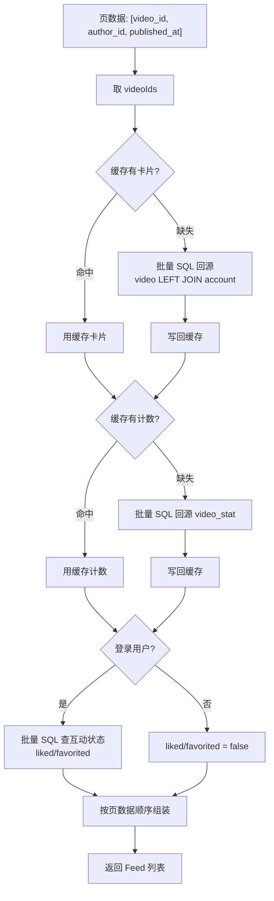

**为什么分两阶段**：页数据查询要快（走索引、不 JOIN），卡片组装要全（JOIN 作者表拿昵称头像）。分开后，页数据可以长时间缓存（页面顺序稳定），卡片和计数可以短时间缓存（内容新鲜度要求不同）。

**N+1 规避**：缓存方案的卡片组装阶段最多 **3 次 SQL**（卡片、计数、互动状态）+ **3 次 Redis 批量读**；页缓存未命中还需一次分页 SQL，与页大小无关。当前无缓存版本的总查询次数见 §5.0。绝不能写成循环里逐个查视频：

```java
// 错误：N+1 查询
for (Long videoId : videoIds) {
    Video video = videoMapper.selectById(videoId);   // 100 条就是 100 次查询
}
```

### 5.4 卡片装配顺序

按**页数据（阶段一的顺序）**组装，而不是按卡片查询结果的顺序：

```java
List<FeedItemVO> items = new ArrayList<>(page.size());
for (FeedPageItem pageItem : page.getItems()) {          // 保持页数据顺序
    FeedCard card = cardMap.get(pageItem.getVideoId());
    if (card == null) {
        continue;   // 卡片缺失（视频被下架/删除）静默跳过
    }
    // 组装
}
```

**卡片缺失时跳过而不是返回占位**：页数据是 45 秒前缓存的，期间视频可能被删除。此时应该少返回一条，而不是返回一条空卡片。

**注意**：这会导致返回条数可能少于 `limit`，但 `has_more` 仍按阶段一的结果判定。这是可接受的 —— 客户端会继续请求下一页。

### 5.5 Following 场景的推拉混合（后续规划）

大 V 发布一次要推给几十万粉丝，写放大会打爆 Redis。因此按粉丝数分流：

| 作者类型 | 判定 | 策略 |
| --- | --- | --- |
| 普通作者（粉丝 < 10000） | — | **推模式**：发布时把视频推到每个粉丝的收件箱 |
| 大 V（粉丝 >= 10000） | — | **拉模式**：只写作者自己的发件箱，粉丝读时主动拉取 |

读取时合并两个来源：

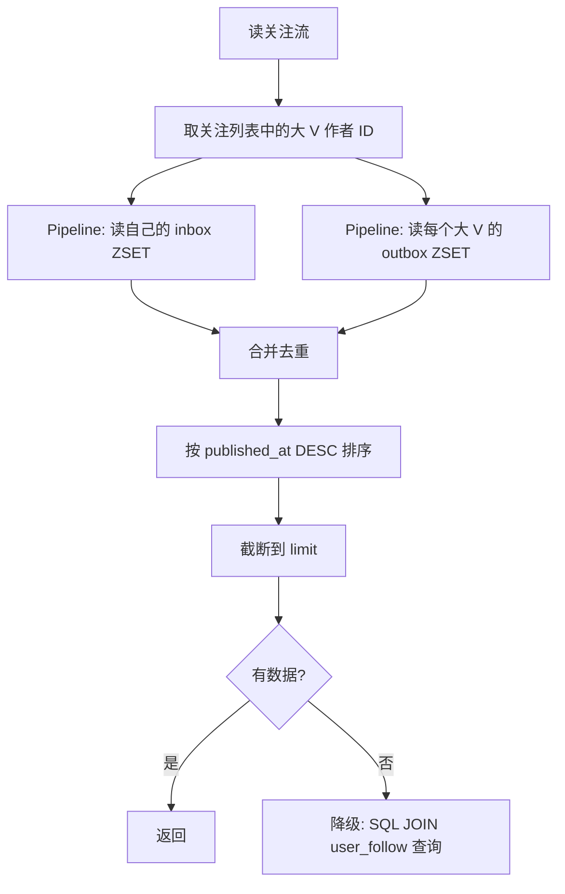

> 大 V 的粉丝数阈值 `10000` 与原 Go 项目一致（`BigCreatorFollowerThreshold`）。这个值应该是可配置的，不同业务规模下最优点不同。

### 5.6 事务边界

Feed 是**只读**操作，不加事务。这也是它能大量用缓存的原因。

---

## 6. recommendation 推荐模块

### 6.1 职责

召回候选、排序、打散、曝光去重。作为 Feed 的 `recommend` 场景的数据源，同时提供内部接口给其他服务调用。

### 6.2 三段式流程

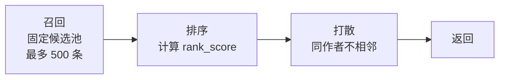

### 6.3 召回

```sql
SELECT v.id, v.author_id, vs.like_count, vs.comment_count, vs.favorite_count, v.published_at
FROM video v
LEFT JOIN video_stat vs ON vs.video_id = v.id
LEFT JOIN exposures e
       ON e.user_id = #{userId} AND e.video_id = v.id
      AND e.last_exposed_at >= #{windowStart}
WHERE v.status = 2 AND v.published_at IS NOT NULL
  AND e.video_id IS NULL
ORDER BY (COALESCE(vs.like_count,0) * 3
        + COALESCE(vs.comment_count,0) * 5
        + COALESCE(vs.favorite_count,0) * 4) DESC,
         v.published_at DESC, v.id DESC
LIMIT #{poolLimit}
```

**池大小**：首次查询固定最多 500 条，与页大小无关。配置 `gcfeed.recommendation.pool-limit` 可调低，不能超过 500。候选池耗尽后通过新首屏请求重新召回。

**曝光去重在召回阶段就做**：`LEFT JOIN exposures` 加 `IS NULL` 过滤 7 天内已曝光的视频，避免把已经看过的内容排进候选池浪费排序算力。

### 6.4 排序算法

```
热度分   hotScore = likeCount × 3 + commentCount × 5 + favoriteCount × 4
新鲜度   freshness = 1 / (1 + hoursSincePublished / 72)
相似度   similarity = cosine(用户兴趣向量, 视频向量)

有用户向量时：
    rankScore = similarity × 0.70 + log1p(hotScore)/10 × 0.20 + freshness × 0.10

无用户向量时（新用户/冷启动）：
    rankScore = log1p(hotScore)/10 × 0.65 + freshness × 0.35
```

**设计说明**

| 项 | 说明 |
| --- | --- |
| 评论权重最高（5） | 评论的创作成本最高，是更强的兴趣信号 |
| 收藏次之（4） | 收藏表示「以后还想看」，比点赞更强的留存意图 |
| 点赞最低（3） | 成本最低，噪声最大 |
| `log1p(hotScore)/10` | 把热度压缩到 0~1 附近。不用 `log` 直接除以 10 是因为 `hotScore = 0` 时 `log(0)` 是负无穷 |
| 新鲜度半衰 72 小时 | `hours = 72` 时 `freshness = 0.5` |
| 权重 0.7 / 0.2 / 0.1 | 内容匹配为主，热度为辅，新鲜度做微调 |

**用户兴趣向量**：取用户最近 30 天最多 200 条 `play` / `complete` 事件，按 `created_at DESC, id DESC` 选取对应模型的向量，按权重加权平均后 L2 归一化。维度不匹配、非有限数和零范数向量跳过；加权结果无有效范数时走冷启动。

| 事件 | 权重 |
| --- | --- |
| `complete` | 3 |
| `play` 且 `completed = true` | `min(1 + watchMs/30000.0, 2) + 1` |
| `play` | `min(1 + watchMs/30000.0, 2)` |
| 其他 | 1 |

没有有效样本（新用户）→ `hasUserVector = false`，走冷启动权重。

### 6.5 打散

避免同一页里出现太多同一作者的内容。

```java
// 第一遍：顺序输出，遇到与上一条同作者的就先跳过
// 后续轮次：反复扫描暂存队列，把与当前输出尾部作者不同的追加进去
// 若一轮没有任何进展，把剩余全部追加后结束（保证不死循环）
```

**必须保证不死循环**：如果剩余的全是同一作者，直接追加输出，不能无限重试。

### 6.6 排序快照分页

Java 使用 Redis 冻结一次召回的评分与顺序，有效期 30 分钟，读取不续期。快照绑定用户、归一化场景、模型与维度；URL-safe Base64 JSON 游标记录 `version=1`、`snapshotId`、`offset`。

每页批量检查剩余候选是否仍上线、是否已有最近 7 天曝光，跳过失效候选继续取满页。先截取再做页内打散；偏移按打散前最后选中条目的快照位置推进，`has_more` 根据剩余有效候选判断。新增视频、热度、画像和时间变化不会重排现有快照。

非法或跨用户/场景游标返回 400/70002；有效游标对应快照已过期或不存在返回 410/70013。模型空间变化要求刷新。快照存储失败返回 500/70011，不能降级成另一种分页算法。调用推荐查询本身不写曝光。

### 6.7 缓存与配置

本轮只实现必需的排序快照与 5 分钟用户画像缓存。画像键包含用户、模型和维度，冷启动空画像也缓存。画像缓存读写失败回源计算并记录日志；新增行为最多 5 分钟后进入画像，不新增事件消费者或缓存失效广播。

候选池短缓存与单视频向量长缓存留到后续有实际性能证据时再引入。召回、向量和卡片均批量查询。配置默认值：`pool-limit=500`、`profile-sample-limit=200`、`exposure-window-days=7`、`profile-window-days=30`、`snapshot-ttl-seconds=1800`、`profile-ttl-seconds=300`。

---

## 7. exposure 曝光模块

内部批次先批量校验上线视频，再按视频 ID 升序写入，统一秒级时间；响应恢复去重输入顺序。公共单条与内部批次共用持久化逻辑。

### 7.1 职责

接收客户端上报的观看行为，写入流水表并维护曝光聚合。

### 7.2 两类事件的语义

| `event_type` | 含义 | 是否写曝光聚合 |
| --- | --- | --- |
| `exposed` | 视频出现在屏幕上 | ✅ 是 |
| `play` | 本次观看退出或首次完播时汇总实际播放时长 | ❌ 否 |
| `complete` | 完播 | ❌ 否 |
| `skip` | 跳过 | ❌ 否 |

只有 `exposed` 才代表「用户看到了这个视频」，用于推荐去重。其他三类是**播放质量与兴趣信号**，用于推荐特征。

### 7.3 幂等语义的取舍

| 表 | 幂等策略 |
| --- | --- |
| `video_view_events`（流水） | **不去重**，重复上报插多行 |
| `exposures`（聚合） | `uk_user_video` + `exposure_count + 1` |

**为什么流水表故意不去重**：

- 重复曝光本身是有价值的信号（用户反复刷到同一个视频说明什么？可能是不感兴趣但推荐系统一直在推）。
- 流水表写入量最大，加唯一索引会显著增加写入开销与锁竞争。
- 去重的判断由聚合表承担，它才是推荐召回去重的数据源。

**聚合表的重复上报会累加计数**，不是「返回首次结果」。这与点赞/收藏的幂等语义不同 —— 曝光是「次数」语义，点赞是「状态」语义。

### 7.4 聚合写入

```sql
INSERT INTO exposures (user_id, video_id, first_exposed_at, last_exposed_at, exposure_count, last_scene)
VALUES (#{userId}, #{videoId}, NOW(), NOW(), 1, #{scene})
ON DUPLICATE KEY UPDATE
    last_exposed_at = NOW(),
    exposure_count = exposure_count + 1,
    last_scene = VALUES(last_scene),
    updated_at = NOW()
```

`ON DUPLICATE KEY UPDATE` 依赖 `uk_user_video`。这样一次 SQL 完成「不存在则插入，存在则更新」，是并发安全的。

> MySQL 8.0.20 起 `VALUES(col)` 语法被标记为废弃，推荐用别名形式：`AS new ON DUPLICATE KEY UPDATE last_scene = new.last_scene`。实现时注意 MySQL 版本。

### 7.5 批量写入的事务边界

`/internal/exposures` 是批量接口：

```java
@Transactional(rollbackFor = Exception.class)
public ExposureResultVO saveExposures(List<ExposureInput> inputs) {
    // 服务端按 videoId 去重（保留首次出现顺序）
    for (ExposureInput input : deduplicated) {
        // 校验视频存在且 status = 2，不存在则抛 404
        // 写流水 + upsert 聚合
    }
}
```

**整批回滚**语义：任一视频不存在则全批失败，不做部分成功。整批失败后可以重新请求；成功响应后的重放会再次累加，接口不提供请求幂等。

---

## 8. message 消息模块

### 8.1 职责

站内通知的生成、列表、未读计数、批量已读。

**边界**：本模块**不产生业务事实**，只是互动、关注等模块的下游投影。

### 8.2 消息来源

| 来源 | `type` | `event_id` 格式 | 触发时机 |
| --- | --- | --- | --- |
| 点赞 | `LIKE` | `interaction:like:{videoId}:{userId}` | 首次点赞（delta > 0） |
| 评论 | `COMMENT` | `interaction:comment:{commentId}` | 评论创建成功 |
| 关注 | `FOLLOW` | `relation:follow:{targetUserId}:{userId}` | 关注成功 |
| 系统 | `SYSTEM` | 由调用方定义 | 无自动生产者 |

**自我操作不通知**：自己赞自己的视频、自己评论自己的视频，都不生成消息。

### 8.3 双重幂等通道

| 唯一索引 | 触发来源 | 语义 |
| --- | --- | --- |
| `uk_user_event (user_id, event_id)` | 内部业务事件 | 同一事件只通知一次 |
| `uk_user_idempotency (user_id, idempotency_key)` | 内部接口直接调用 | 同一请求只通知一次 |

业务调用时通常把 `event_id` 同时作为 `idempotency_key`，因此两个索引同时生效。

**命中幂等的处理**：回查已存在记录，返回它的内容，**丢弃本次请求的 title / content / actor**。

```java
try {
    messageMapper.insert(message);
    return new CreateResult(message, true);   // 新建
} catch (DuplicateKeyException ex) {
    Message existing = messageMapper.findExisting(userId, eventId, idempotencyKey);
    return new CreateResult(existing, false);  // 幂等命中
}
```

**查找已有记录时的条件构造**：`event_id` 和 `idempotency_key` 可能只传了其中一个，需要动态拼接 `WHERE` 条件。两个都没传时说明不是幂等场景，直接抛异常（不应该走到这里）。

### 8.4 「尽力而为」语义

消息写入失败**绝不能影响主流程**：

```java
// 在 InteractionServiceImpl 中
private void notifyLike(Long videoId, Long likerId) {
    try {
        Video video = videoMapper.selectById(videoId);
        if (video == null || video.getAuthorId().equals(likerId)) {
            return;   // 视频不存在或自己赞自己，不通知
        }
        messageWriter.createFromActorEvent(...);
    } catch (Exception ex) {
        // 只记日志，不抛出
        log.warn("点赞通知发送失败 videoId={} likerId={}", videoId, likerId, ex);
    }
}
```

**为什么**：用户点赞成功了，不应该因为「通知发不出去」而返回失败。通知是可以丢失的非核心数据。

**但要有可观测性**：失败要记日志（原 Go 实现完全吞掉错误，连日志都没有，这是缺陷）。建议进一步加指标计数 `message_writer_failure_total`，便于发现通知链路整体故障。

### 8.5 批量已读的语义细节

```sql
UPDATE user_message
SET is_read = 1, read_at = NOW(), updated_at = NOW()
WHERE user_id = #{userId}
  AND is_read = 0
  AND deleted = 0
  <if test="messageIds != null and messageIds.size() > 0">
  AND id IN (...)
  </if>
```

返回 `affectedRows` 作为 `updated_count`。

| 场景 | `updated_count` |
| --- | --- |
| 标记 3 条未读为已读 | 3 |
| 再次标记同样的 3 条 | 0（已经已读，`is_read = 0` 过滤掉了） |
| 传入不属于自己的消息 ID | 0（`user_id` 条件过滤） |
| 传空数组 `[]` | 全部未读消息的数量 |

**不返回 403 而是静默过滤**：传入他人的消息 ID 时不报错、不泄露该消息是否存在，返回 `updated_count = 0` 即可。

### 8.6 未读计数

```sql
SELECT COUNT(*) FROM user_message WHERE user_id = ? AND is_read = 0 AND deleted = 0
```

走 `idx_user_read_created (user_id, is_read, created_at)` 索引。

原 Go 实现这个查询**没有缓存，每次直打 MySQL**。前端在**每次路由切换**时都会请求未读数，属于高频调用。建议加 60 秒的 Redis 缓存，在消息写入/已读时主动失效。

---

## 9. playback 播放优化模块

### 9.1 职责

端侧播放参数下发、预加载建议、播放质量上报。**不做转码或推流**。

### 9.2 三级配置回退

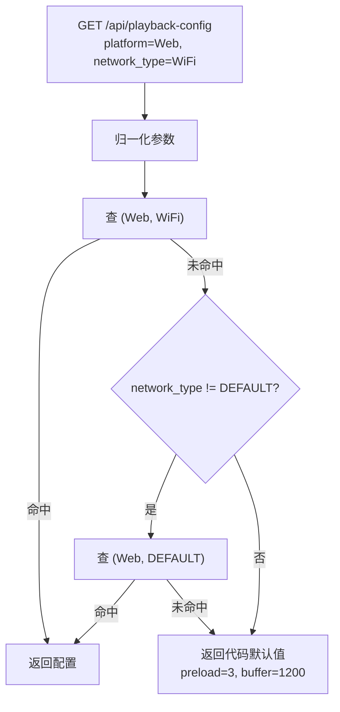

**第二级回退的意义**：只需要维护一份「平台默认配置」，不必为每个网络类型都配一行。例如 Android 只配了 `(Android, DEFAULT)`，那所有 Android 的网络类型都会回退到这一行。

### 9.3 参数归一化

| 参数 | 规则 |
| --- | --- |
| `platform` | 去空格；空 → `Web`；**不转大小写** |
| `network_type` | 去空格；空 → `DEFAULT`；`wifi`/`wi-fi` → `WiFi`；`3g`/`4g`/`5g` → 大写；其他转大写 |

`platform` 不归一大小写是原实现的取舍。这意味着 `web` 和 `Web` 会命中不同行。实现时保持一致，但在文档里标注这个行为，避免运维困惑。

### 9.4 结果钳制

```java
if (config.getPreloadCount() <= 0) config.setPreloadCount(3);
if (config.getPreloadCount() > 10)  config.setPreloadCount(10);
if (config.getBufferMs() <= 0)      config.setBufferMs(1200);
```

**为什么在读取时钳制而不是在写入时校验**：当前没有配置写入接口（只有 `sql/data.sql` 手动插入）。钳制在读取侧可以防止手工写错数据导致端侧拉取到异常参数（比如预加载 1000 条会打爆用户流量）。

### 9.5 预加载方向

**返回比当前视频更早发布的 N 条**，即「继续往下滑」的下一批。

原 Go 文档写的是「当前视频后续若干条视频资源」，「后续」容易被理解为「更新发布的」。实现与文档不一致。本版本按**实现**（时间倒序的后续条目）设计，与用户「往下滑」的直觉一致。

### 9.6 QoS 幂等

```java
try {
    qosLogMapper.insert(log);
    return new QoSResult(log, true);      // 201
} catch (DuplicateKeyException ex) {
    QoSLog existing = qosLogMapper.findByUserAndKey(userId, idempotencyKey);
    return new QoSResult(existing, false); // 200，返回首次上报的指标值
}
```

**幂等键为空时**：`idempotency_key` 列写 `NULL`，唯一索引不去重，每次上报都是新行。这符合预期 —— 客户端不传键就是不要求幂等。

**重放返回首次值**：客户端重试时传了不同的指标值（比如 `first_frame_ms: 999`），响应仍然返回首次的 `186`。这样客户端能获得稳定结果。

---

## 10. upload 上传模块

### 10.1 职责

接收 multipart 文件，校验类型与元数据，保存到本地磁盘。

### 10.2 校验流程

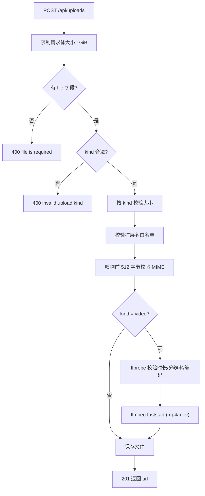

### 10.3 三层大小限制

| 限制 | 值 | 作用 |
| --- | --- | --- |
| 请求体总大小 | 1 GiB | 在读请求体前就限制，防止撑爆内存/磁盘 |
| 视频文件 | 512 MiB | 按 `kind` 细分 |
| 图片文件 | 20 MiB | — |

**在读取之前限制**：Spring 的 `MaxUploadSizeExceededException` 会在读 multipart 时触发，由全局异常处理器转成 `400`。这是最外层防线。

### 10.4 视频元数据校验

调用 `ffprobe`：

```bash
ffprobe -v error \
        -show_entries stream=codec_type,codec_name,width,height:format=duration \
        -of json <path>
```

| 项 | 限制 |
| --- | --- |
| 超时 | 30 秒 |
| 时长 | > 0 且 <= 600 秒 |
| 分辨率 | 宽高均 > 0 且 <= 3840（4K） |
| 视频编码 | `h264` `h265` `hevc` `vp8` `vp9` `av1` |
| 音频编码 | `aac` `mp3` `opus` `vorbis` |

**必须存在至少一条视频流**，否则返回「元数据无效」。

### 10.5 faststart 处理

MP4 / MOV 的元数据（moov box）默认可能在文件末尾，导致播放器必须下载完整个文件才能开始播放。faststart 把元数据移到文件开头：

```bash
ffmpeg -y -i <原文件> -map 0 -c copy -movflags +faststart -f mp4 <临时文件>
```

| 要点 | 说明 |
| --- | --- |
| `-c copy` | 不重新编码，只重排容器结构，速度快 |
| 临时文件建在**同目录** | 保证 `rename` 是同文件系统的原子操作，不会跨设备失败 |
| 成功后 `rename` 覆盖原文件 | 原子替换，不会出现半成品文件 |
| 失败时删除文件 | 不留垃圾 |

### 10.6 错误信息的安全处理

原 Go 实现把 `ffmpeg` 的 stderr 拼进了错误响应：

```
"video faststart failed: ffmpeg version 6.0 Copyright (c) 2000-2023 ... /usr/local/bin/ffmpeg ..."
```

这会泄露工具版本与服务器路径。本版本改为：

- 完整信息记 `error` 日志（便于排查）。
- 对外统一返回 `video faststart failed`。

### 10.7 状态码区分

| 类型 | 状态码 | 例子 |
| --- | --- | --- |
| 用户输入问题 | 400 | 扩展名不支持、文件过大、时长超限、编码不支持 |
| 服务端环境问题 | 500 | `ffprobe` / `ffmpeg` 不存在、faststart 执行失败、磁盘写入失败 |

区分标准：**换个文件能不能成功**。换文件能成功的是用户输入问题（400），换文件也不行的（工具缺失）是服务端问题（500）。

---

## 11. 规划中模块的设计要点

以下模块在 Go 项目中只有文档、无实现。本版本已把表结构写入 `schema.sql`，功能留待后续实现。

### 11.1 review 审核模块

**目标流程**

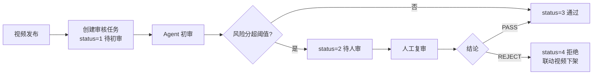

**关键设计点**

| 点 | 说明 |
| --- | --- |
| Agent 结果总是写日志 | 无论通过还是驳回都写 `review_decision_log`，保留完整决策链 |
| 重复回传 Agent 结果幂等 | 必须返回同一审核状态，不能因为重复调用改变状态 |
| 驳回联动下架 | 更新 `review_task.status` 的同时把 `video.status` 改为 3（下架） |
| 人审权限 | 需要 `admin` 角色，非管理员返回 403 |
| 审核结果通知 | 通过 `message` 模块发 `SYSTEM` 消息，`event_id` 形如 `review:decision:{taskId}` |

**表结构缺口已补**：`review_task` 补上了 `assignee_id`（原文档提到「分配审核员」但表设计无该列）。

### 11.2 admin 后台运营模块

**目标能力**：视频条件查询、审核任务查询、审核员分配、运营配置管理、操作审计。

**关键设计点**

| 点 | 说明 |
| --- | --- |
| 双角色分级 | 运营可查可分配；**只有管理员**能改配置 |
| 审计强制 | 下架、分配、改配置都必须写 `admin_action_log` |
| 审计实现 | 用 AOP + `@Audited` 注解，避免在每个业务方法里手写审计代码 |
| 分页风格 | 复用 Feed 的游标分页，不用 offset 分页（offset 在数据量大时性能差） |

### 11.3 governance 系统治理模块

**关键设计点**

| 点 | 说明 |
| --- | --- |
| 限流决策由服务计算 | 不在网关/中间件硬编码规则，便于多副本共享状态 |
| 降级开关只下发状态 | 内部服务读到开关后自行决定关什么，不下发规则 |
| 死信重试有次数上限 | 超过上限置 `status = 3`（放弃），避免无限重试 |
| 与 MQ 整合 | 为队列配 DLX，DLQ 消费者写 `governance_dead_letter`，由重试接口驱动重投 |

**原项目的 MQ 缺口**：Go 实现无 DLX，失败消息 `Nack(requeue=true)` 无限回原队列，毒消息会形成无退避热循环。本版本在 `governance_dead_letter` 表设计上预留了整合位置。

### 11.4 monitoring 监控告警模块

**关键设计点**

| 点 | 说明 |
| --- | --- |
| 与 Prometheus 的边界 | Prometheus 承接技术指标（HTTP 耗时、QPS），本模块承接业务看板数据（Feed 曝光量、互动率） |
| 指标值类型 | `DOUBLE` 而非整数，业务指标可能是比率 |
| 告警状态机 | `FIRING` → `RESOLVED`，两个时间戳都留 |
| 写入幂等 | 建议用 `(metric_name, ts, labels_hash)` 做唯一键 |
