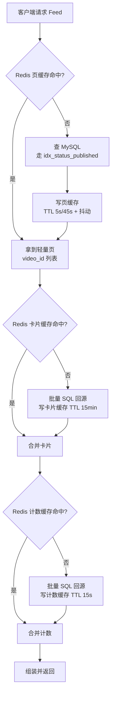
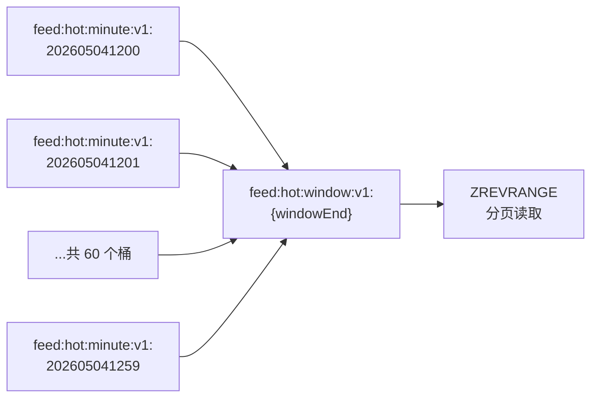
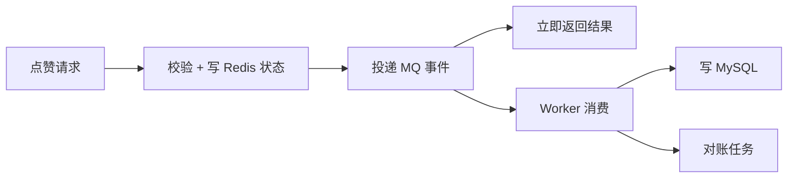

# 06 缓存与性能设计

Feed 是读多写少、延迟敏感的主链路。本文说明当前查询实现，以及后续缓存分层、Redis 键设计、热点场景与异步链路规划。

**当前已实现：基础 Timeline 直接查库**

1. `FeedRepositoryImpl` 用 MyBatis-Plus 查询视频卡片所需字段，按 `published_at DESC, id DESC` 取 `limit + 1` 条，关闭 count。过滤上线、未删除和非空发布时间。
2. Service 截断到 limit 后，Repository 分别批量查询去重作者 ID 和本页视频统计，仅查询展示所需列。
3. 登录用户再批量查询本页互动状态；匿名不查互动表。缺失作者与统计采用空值 / 零值兜底，保持原视频顺序。

匿名非空页最多 3 次 SQL，登录非空页最多 4 次，空页仅 1 次。集成测试通过 JDBC prepare 拦截统计实际 SQL，在 limit 为 1、10、100 时验证查询次数不变且没有 count 或深 offset。

本次不使用 Feed 页 / 卡片 / 计数缓存，也不实现 RabbitMQ；JWT 黑名单继续使用现有 Redis 能力。以下缓存方案、性能目标和异步链路为后续规划，不能视作已实现或已测得指标。

## 1. 性能目标

| 场景 | 目标 P95 | 说明 |
| --- | --- | --- |
| 视频详情 | < 30 ms | 主键查询 + Redis 计数缓存 |
| Feed 首页 | < 80 ms | 走缓存，回源时走索引 |
| Feed 翻页 | < 60 ms | 翻页数据更稳定，缓存命中率更高 |
| 点赞/收藏 | < 50 ms | 单事务，两表更新 |
| 发布视频 | < 100 ms | 含幂等检查与缓存预热 |

## 2. 缓存分层



**四种缓存的数据特征对比**

| 缓存对象 | 内容 | 变化频率 | TTL | 理由 |
| --- | --- | --- | --- | --- |
| **页** | `video_id` 列表 + 游标 | 低（只有新视频插入时首屏变化） | 首页 5s / 翻页 45s | 首页变化快需要短空窗；翻页结果稳定可以长缓存 |
| **卡片** | 标题、封面、作者昵称头像 | 极低（编辑视频标题很少见） | 15 分钟 | 展示字段几乎不变，长 TTL 收益大 |
| **计数** | 点赞/评论/收藏数 | 高（每次互动都变） | 15 秒 | 用户对数字新鲜度的容忍度是「十几秒」，长 TTL 会让人感觉「点了没反应」 |
| **互动状态** | 当前用户的 liked/favorited | 中（用户自己操作才变） | 30 天 | 只有用户自己操作会改，可以由写操作主动失效 |

**TTL 差异的原因**：同一个 Feed 请求涉及的三类数据，变化频率相差三个数量级。用统一 TTL 会导致要么计数不够新鲜、要么页缓存频繁失效。

## 3. Redis 键设计

### 3.1 键清单

| 用途 | 键模板 | 结构 | TTL |
| --- | --- | --- | --- |
| Feed 首页 | `feed:page:v1:{scene}:limit:{limit}:first` | String(JSON) | 5s + 抖动 |
| Feed 翻页 | `feed:page:v1:{scene}:limit:{limit}:cursor:{sha1(cursor)}` | String(JSON) | 45s + 抖动 |
| 视频卡片 | `video:card:v1:{videoId}` | String(JSON) | 15 分钟 |
| 视频计数 | `video:stat:v1:{videoId}` | String(JSON) | 15 秒 |
| 计数基数 | `video:stat:counter:v1:{videoId}:base` | Hash | 24 小时 |
| 计数分片 | `video:stat:counter:v1:{videoId}:shard:{0..15}` | Hash | 24 小时 |
| 互动状态 | `interaction:action:v1:{userId}:{videoId}:{actionType}` | Hash | 30 天 |
| 关注流收件箱 | `feed:following:inbox:v1:{userId}` | ZSet | 30 天 |
| 大 V 发件箱 | `feed:following:author:v1:{authorId}` | ZSet | 30 天 |
| 热榜分钟桶 | `feed:hot:minute:v1:{yyyyMMddHHmm}` | ZSet | 2 小时 |
| 热榜窗口 | `feed:hot:window:v1:{windowEndEpochSec}` | ZSet | 2 分钟 |
| 令牌黑名单 | `auth:blacklist:v1:{jti}` | String | 令牌剩余有效期 |
| 幂等结果 | `idempotent:v1:{scope}:{userId}:{key}` | String(JSON) | 24 小时 |

### 3.2 页缓存键的游标处理

翻页的缓存键不能直接拼原始游标 —— 游标是 Base64 字符串，长度可达上百字符，直接做键会让键变得很长。因此取 SHA-1：

```java
public static String feedPageCacheKey(FeedScene scene, String cursor, int limit) {
    String normalizedCursor = cursor == null ? "" : cursor.trim();
    if (normalizedCursor.isEmpty()) {
        return "feed:page:v1:%s:limit:%d:first".formatted(scene.getValue(), limit);
    }
    String hash = DigestUtils.sha1Hex(normalizedCursor);
    return "feed:page:v1:%s:limit:%d:cursor:%s".formatted(scene.getValue(), limit, hash);
}
```

`limit` 也进键，因为不同 `limit` 的页数据不同。`scene` 先归一化（去空格转小写）再进键，避免 `Timeline` 和 `timeline` 产生两个键。

## 4. TTL 抖动

### 4.1 问题

如果大量缓存键在同一时刻写入、且 TTL 相同，它们会在同一时刻集中过期，导致瞬时回源请求打满数据库。这就是**缓存雪崩**。

### 4.2 方案

给 TTL 加 10%~20% 的随机偏移：

```java
public static Duration withJitter(Duration baseTtl, String cacheKey) {
    if (baseTtl.isZero() || baseTtl.isNegative()) {
        return Duration.ZERO;
    }
    // 用缓存键的哈希决定抖动系数，保证同一个键每次算出的 TTL 固定
    int jitterPercent = 10 + Math.floorMod(cacheKey.hashCode(), 11);   // 10 ~ 20
    return baseTtl.plusMillis(baseTtl.toMillis() * jitterPercent / 100);
}
```

### 4.3 为什么抖动系数要用键的哈希而不是随机数

用随机数的写法：

```java
int jitterPercent = 10 + ThreadLocalRandom.current().nextInt(11);   // 每次调用都不同
```

后果：**同一个键的 TTL 每次都不同**。这会带来两个问题：

1. 排查问题时无法复现「这个键的 TTL 到底应该是多少」。
2. 如果某处逻辑依赖「键在写入后 N 秒内一定存在」，随机 TTL 会让这个假设不成立。

用键的哈希则保证「同一个键 → 固定 TTL」，同时不同键之间仍然是分散的。这是一个用确定性换可观测性的权衡，代价是分散度略低于真随机，但足够了。

## 5. Feed 页缓存与缓存击穿

### 5.1 缓存击穿问题

首页缓存 TTL 只有 5 秒，会在短时间内过期多次。如果某一刻有 1000 个请求同时到达且缓存刚过期，它们会同时回源查数据库 —— 这就是**缓存击穿**。

### 5.2 单机方案：进程内合并

原 Go 项目用 `singleflight` 合并同一个键的并发回源：

```go
value, err, _ := group.Do(cacheKey, func() (any, error) {
    // 二次检查缓存
    // 回源
    // 写缓存
})
```

Java 的等价实现是 **Caffeine** 的 `get(key, loader)`（同步加载，同键并发只有一个线程执行 loader），或手写 `ConcurrentHashMap<String, CompletableFuture<T>>` 做键级合并。

推荐用 Caffeine，它同时提供本地缓存能力：

```java
private final Cache<String, FeedPage> localMergeCache = Caffeine.newBuilder()
        .maximumSize(1000)
        .expireAfterWrite(Duration.ofSeconds(3))   // 只用于合并，不需要长存
        .build();

FeedPage page = localMergeCache.get(cacheKey, key -> loadPageFromRedisOrDb(key));
```

### 5.3 分布式方案：Redisson 分布式锁

单机 `singleflight` 只在单个 JVM 内合并。多副本部署时，N 个副本会各回源一次。更彻底的方案是用分布式锁：

```java
RLock lock = redissonClient.getLock("lock:feed:page:v1:" + cacheKey);
boolean acquired = lock.tryLock(200, 3000, TimeUnit.MILLISECONDS);
if (acquired) {
    try {
        // 二次检查缓存（双检）
        FeedPage cached = readPageCache(cacheKey);
        if (cached != null) {
            return cached;
        }
        FeedPage page = loadFromDb();
        writePageCache(cacheKey, page);
        return page;
    } finally {
        lock.unlock();
    }
}
// 没拿到锁：短暂等待后重试读缓存，或直接降级回源
```

**注意**：`unlock()` 必须在 `finally` 里，且要判断 `lock.isHeldByCurrentThread()`，否则可能抛 `IllegalMonitorStateException`。

### 5.4 两种方案的取舍

| 方案 | 优点 | 缺点 | 适用 |
| --- | --- | --- | --- |
| 本地合并 | 无网络开销，无锁竞争 | 只合并单机 | 单副本部署，或作为第一层 |
| 分布式锁 | 全集群合并 | 每次回源多一次 Redis 往返 + 锁等待 | 多副本 + 热点键 |

**推荐的组合**：本地合并作为第一层（挡住单机内的并发），分布式锁作为第二层（挡住跨副本的并发）。这样大部分并发在本地就被合并掉了，只有跨副本的那几个请求才会竞争分布式锁。

当前阶段（单副本开发环境）**本地合并已经足够**，分布式锁作为多副本部署时的增强项。

## 6. 计数缓存的设计

### 6.1 简单方案与它的局限

最简单的方式是「`video_stat` 表 + 15 秒 JSON 缓存」。这在本项目当前的规模下完全够用：

```java
String key = "video:stat:v1:" + videoId;
String json = redis.get(key);
if (json == null) {
    VideoStat stat = videoStatMapper.selectById(videoId);
    redis.set(key, toJson(stat), Duration.ofSeconds(15));
}
```

### 6.2 原项目的复杂方案

原 Go 项目为了实现「计数近实时可见」，做了一个三层结构：

| 层 | 键 | 作用 |
| --- | --- | --- |
| JSON 快照 | `video:stat:v1:{id}` | 读取入口，15 秒 TTL |
| 基数 Hash | `video:stat:counter:v1:{id}:base` | 从 MySQL 读出的基数值，24 小时 TTL |
| 分片 Hash × 16 | `video:stat:counter:v1:{id}:shard:{0..15}` | 增量计数，按 `userId % 16` 分散 |

读取时：`最终值 = 基数 + 所有分片的增量之和`。

**这个设计解决的问题**：如果所有点赞都 `INCR` 同一个键，这个键会成为 Redis 的热点（单线程处理，所有请求排队）。分片到 16 个键可以让并发分散。

**它的代价**：

- 读取要从 1 次 GET 变成 17 次 HGETALL（用 Pipeline 合并成 1 个往返，但仍是 17 个命令）。
- 写入要维护基数与分片的初始化和过期同步，逻辑复杂。
- 调试困难：Redis 里的值和数据库的值不一致时，要判断是哪个环节的问题。

### 6.3 本版本的取舍

**P0 阶段采用简单方案**（`video_stat` + 15 秒 JSON 缓存），理由：

1. **热点分片解决的是 Redis 单键的吞吐上限问题**（单键约 10 万 QPS）。本项目当前的数据规模远未达到这个量级。
2. 简单方案的**计数最终一致性仍然成立** —— 15 秒后缓存过期，读到的是数据库的准确值。
3. 复杂度换来的收益在这个规模下不成立，属于**过早优化**。

**保留升级路径**：计数的读写集中在一个 `VideoStatService` 中，将来需要分片时只改这个类的实现，调用方不变。

**什么时候该升级**：当单个视频的点赞 QPS 稳定超过 1 万时（可以用 `video_stat_incr_total{videoId}` 指标观测），再引入分片。

## 7. 热榜设计

### 7.1 数据结构

**分钟桶 + 滑动窗口**：



### 7.2 写入

互动发生时，往**当前分钟**的桶加分：

```java
String minuteKey = "feed:hot:minute:v1:" + DateTimeFormatter.ofPattern("yyyyMMddHHmm")
        .format(LocalDateTime.now(ZoneOffset.UTC));

RScoredSortedSet<String> bucket = redissonClient.getScoredSortedSet(minuteKey);
bucket.addScore(member, scoreDelta);
bucket.expire(Duration.ofHours(2));
```

**分数权重**

| 行为 | 权重 |
| --- | --- |
| 点赞 / 取消点赞 | +3 / -3 |
| 收藏 / 取消收藏 | +4 / -4 |
| 评论 / 删除评论 | +5 / -5 |

权重与原项目一致。评论权重最高是因为创作成本最高。

### 7.3 成员编码

成员是**20 位零填充的视频 ID 字符串**：

```java
String member = String.format("%020d", videoId);   // videoId=103 → "00000000000000000103"
```

**为什么零填充**：Redis 的 ZSet 在分数相同时按成员字典序排列。如果成员是 `"103"` 和 `"99"`，字典序是 `"103" < "99"`（因为 `'1' < '9'`），与数值序相反。零填充后 `"000...0103"` 与 `"000...0099"` 的字典序与数值序一致，同分时的排序才是稳定的、可预期的。

**还原**：`member.replaceFirst("^0+", "")` 再 `Long.parseLong`，全 0 或解析失败则跳过该成员。

### 7.4 窗口合并（惰性重建）

读取时不能每次都做 60 个桶的 `ZUNIONSTORE` —— 那是 O(N) 的合并操作。因此引入一个窗口缓存键：

```java
String windowKey = "feed:hot:window:v1:" + windowEndEpochSecond;

if (!redissonClient.getScoredSortedSet(windowKey).isExists()) {
    // 窗口不存在才合并
    List<String> minuteKeys = buildMinuteKeys(windowEnd);   // 最近 60 个分钟桶
    // ZUNIONSTORE windowKey {minuteKeys...} AGGREGATE SUM
    // ZREMRANGEBYSCORE windowKey -inf 0   移除分数 <= 0 的成员
    // EXPIRE windowKey 120s
}

// 分页读取
List<ScoredEntry<String>> entries = window.revRangeWithScores(offset, offset + limit - 1);
```

**`ZREMRANGEBYSCORE -inf 0` 的作用**：取消点赞会让分数变负（比如先点赞 +3，后来 60 分钟内取消 -3）。分数 <= 0 表示该视频在窗口内已经「净负热度」，不应该出现在热榜上。

### 7.5 窗口锚定

翻页时 `window_end` **锚定不变**：

```java
// 首页：取当前时间截断到分钟
LocalDateTime windowEnd = LocalDateTime.now(ZoneOffset.UTC).truncatedTo(ChronoUnit.MINUTES);

// 后续页：从游标里读出 window_end，沿用
if (cursor.getWindowEnd() != null) {
    windowEnd = cursor.getWindowEnd();
}
```

**为什么锚定**：如果每翻一页都重新取当前时间，窗口会滑动，同一批视频的位置会变化，导致翻页出现重复或遗漏。锚定后窗口在翻页期间是快照，配合 `offset` 递增实现稳定分页。

### 7.6 降级路径

Redis 不可用时降级查 MySQL：

```sql
SELECT v.id AS video_id, v.author_id, v.published_at,
       (COALESCE(vs.like_count,0) * 3
      + COALESCE(vs.comment_count,0) * 5
      + COALESCE(vs.favorite_count,0) * 4) AS hot_score
FROM video v
LEFT JOIN video_stat vs ON vs.video_id = v.id
WHERE v.status = 2 AND v.deleted = 0 AND v.published_at IS NOT NULL
ORDER BY hot_score DESC, v.published_at DESC, v.id DESC
LIMIT ?
```

**语义差异**：降级路径返回的是**累计热度**（视频从发布到现在的总热度），Redis 路径返回的是**最近 1 小时热度**。这是可接受的降级 —— 降级时功能可用优先于精确性。降级期间游标形态也随之切换（从 `{window_end, offset}` 变为 `{hot_score, published_at, video_id}`）。

**降级必须记日志**：`log.warn("热榜降级到数据库查询")`，否则运维无法感知 Redis 已经挂了。

## 8. Feed 卡片批量组装

### 8.1 三次批量查询

```java
List<Long> videoIds = page.getItems().stream()
        .map(FeedPageItem::getVideoId)
        .distinct()
        .toList();

// 1. 卡片：video LEFT JOIN account
Map<Long, FeedCard> cards = feedCache.getCards(videoIds);       // Redis MGET
if (cards.size() < videoIds.size()) {
    List<Long> missing = diff(videoIds, cards.keySet());
    Map<Long, FeedCard> loaded = videoMapper.batchGetFeedCards(missing);
    feedCache.setCards(loaded, Duration.ofMinutes(15));
    cards.putAll(loaded);
}

// 2. 计数：video_stat
Map<Long, FeedStat> stats = feedCache.getStats(videoIds);
if (stats.size() < videoIds.size()) {
    // 同样的回源 + 写缓存模式
}

// 3. 互动状态：interaction_action（仅登录用户，不缓存）
Map<Long, ViewerAction> actions = viewerId != null
        ? interactionMapper.batchGetViewerActions(viewerId, videoIds)
        : Map.of();
```

**缓存方案的组装阶段最多 3 次 SQL**，页缓存未命中时另需一次分页 SQL；当前基础版本的总查询次数见本文开头。查询次数必须与页大小无关，不能在循环中逐条访问数据库。

### 8.2 批量查询的写法

当前不使用 Mapper XML。由 Repository 调用已有 `BaseMapper`，通过 LambdaQueryWrapper 构造查询，再按 ID 映射组装：

```java
userMapper.selectList(Wrappers.<User>lambdaQuery()
        .select(User::getId, User::getNickname, User::getAvatarUrl)
        .in(User::getId, authorIds)
        .eq(User::getDeleted, 0));
```

视频统计和互动状态采用同样的批量方式。空 ID 集合直接返回空结果，避免空 IN 或意外全表查询。后续缓存架构如果需要 JOIN，可评估注解 SQL，不新增 Mapper XML。

**`IN` 列表的长度限制**：`IN (?, ?, ...)` 的占位符数量有上限（MySQL 默认 `max_allowed_packet` 限制，实践中建议单批不超过 1000）。Feed 页的 `limit` 上限是 100，不会超。

## 9. index 与 SQL 效率

### 9.1 必须走索引的查询

| 查询 | 索引 | 说明 |
| --- | --- | --- |
| Timeline Feed 页 | `idx_status_published (status, published_at, id)` | 等值 + 范围，无 filesort |
| 评论列表 | `idx_video_status_created (video_id, status, created_at, id)` | 同上 |
| 关注列表 | `idx_user_status_updated (user_id, status, updated_at, target_user_id)` | 同上 |
| 粉丝列表 | `idx_target_status_updated (target_user_id, status, updated_at, user_id)` | 同上 |
| 消息列表 | `idx_user_read_created (user_id, is_read, created_at)` | 未读数可走索引覆盖 |
| 视频详情 | `PRIMARY` + `video_stat` PRIMARY | 主键查询 |
| 互动行为查 | `uk_user_video_type` | 唯一索引 |
| 推荐召回 | `idx_status_published` + `idx_user_last_exposed` | 两个索引配合 |

### 9.2 用 EXPLAIN 验证

上线前对以下查询跑 `EXPLAIN`，确认 `type` 是 `range` 或 `ref`（不是 `ALL`），且 `Extra` 里**没有** `Using filesort`：

```sql
EXPLAIN SELECT v.id, v.author_id, v.published_at
FROM video v
WHERE v.status = 2 AND v.deleted = 0 AND v.published_at IS NOT NULL
  AND (v.published_at < '2026-05-04 12:00:00'
       OR (v.published_at = '2026-05-04 12:00:00' AND v.id < 103))
ORDER BY v.published_at DESC, v.id DESC
LIMIT 11;
```

**`Using filesort` 是游标分页最常见的性能杀手**。如果索引列顺序与 `ORDER BY` 不一致，MySQL 会把结果全取出来排序再分页，数据量大时是灾难。

### 9.3 避免 SELECT *

MyBatis-Plus 的 `selectList` 默认查所有列。`video` 表的 `media_url` / `cover_url` 是 VARCHAR(512)，在 Feed 列表场景下会浪费带宽。**能用 VO 投影的就用投影**：

```xml
<select id="listTimelinePage" resultType="...FeedPageItem">
    SELECT v.id AS video_id, v.author_id, v.published_at   <!-- 只查三列 -->
    FROM video v
    ...
</select>
```

## 10. 异步链路规划

当前阶段互动计数走同步路径（见 [05 模块功能设计](05-模块功能设计.md) 的互动章节）。当写入压力增大时，按以下设计引入异步。

### 10.1 目标架构



### 10.2 队列拓扑

沿用原 Go 项目的命名，便于两端并行运行时对齐：

| Exchange | Routing Key | Queue | 用途 |
| --- | --- | --- | --- |
| `gcfeed.interaction` | `interaction.action_changed` | `gcfeed.interaction.action_changed` | 互动落库 |
| `gcfeed.video` | `video.published` | `gcfeed.video.published` | 发布扇出 |
| `gcfeed.video` | `video.published` | `gcfeed.video.embedding` | 向量生成 |
| `gcfeed.exposure` | `exposure.view_event_recorded` | `gcfeed.exposure.view_event_recorded` | 曝光特征 |

注意 `video.published` 这个 routing key 绑定了**两个**队列（发布扇出 + 向量生成），这是 topic exchange 的扇出能力。

### 10.3 必须补上的机制

原 Go 项目的 MQ 有三个缺口，本版本设计时应一并解决：

| 缺口 | 原实现 | 应改为 |
| --- | --- | --- |
| **无死信队列** | 队列 `args = nil`，无 `x-dead-letter-exchange` | 每队列配 DLX，超过重试次数进 DLQ，写入 `governance_dead_letter` |
| **无限 requeue** | 处理失败 `Nack(requeue=true)` 无限回原队列 | 有限重试（如 3 次），超限 `Nack(requeue=false)` 进 DLQ |
| **无 prefetch 限制** | `args = nil`，无 QoS 设置 | 设置 `prefetch = 10`，避免一次推送过多消息撑爆内存 |

**无限 requeue 的危害**：一条格式错误的消息（毒消息）会反复投递 → 反复失败 → 反复投递，形成无退避的热循环，同时刷爆失败日志和 CPU。

**Spring AMQP 的对应配置**：

```yaml
spring:
  rabbitmq:
    listener:
      simple:
        prefetch: 10
        acknowledge-mode: manual
        retry:
          enabled: true
          max-attempts: 3
          initial-interval: 1000ms
    publisher-confirm-type: correlated   # 发布确认
    publisher-returns: true              # 路由失败回调
```

原 Go 实现发布时 `mandatory=false` 且无 confirm，路由不到队列时消息**静默丢失**。开启 confirm + returns 才能感知投递失败。

### 10.4 一致性策略

异步化引入的核心问题是「Redis 说点赞成功了，但 MySQL 还没落」。

| 机制 | 说明 |
| --- | --- |
| **MQ 投递失败回退同步** | 发布失败时直接走同步路径落库（原项目的做法，保留） |
| **消费端幂等** | 唯一索引 + 幂等键，重复消费不重复计数 |
| **对账任务** | 定时比对 Redis 与 MySQL 的计数差异，超过阈值告警 |
| **缓存 TTL 兜底** | 计数缓存 15 秒过期，最坏情况下的偏差窗口有限 |

## 11. 限流与降级

### 11.1 限流

需要限流的接口与阈值建议：

| 接口 | 维度 | 建议阈值 |
| --- | --- | --- |
| `POST /api/videos/{id}/comments` | 用户 | 10 次 / 分钟 |
| `POST /api/videos/{id}/like` | 用户 | 60 次 / 分钟 |
| `POST /api/uploads` | 用户 | 5 次 / 分钟 |
| `POST /api/video-view-events` | 用户 | 200 次 / 分钟 |
| `POST /api/sessions` | IP | 10 次 / 分钟（防撞库） |
| `POST /api/users` | IP | 5 次 / 分钟（防批量注册） |

实现方案见 [04 技术基础设施设计](04-技术基础设施设计.md) 的限流章节。

### 11.2 降级开关

| 开关 | 关闭后的行为 |
| --- | --- |
| `feed.hot.enabled` | 热榜场景降级为容器查询（累计热度） |
| `feed.cache.enabled` | Feed 全部回源查 MySQL |
| `recommend.enabled` | 推荐场景降级为 timeline |
| `message.push.enabled` | 不生成站内通知 |

**降级开关的设计原则**：

1. **开关只下发状态，不下发规则**。内部服务读到「热榜已关闭」后自行决定怎么降级，而不是由配置中心下发降级逻辑。
2. **降级路径必须是已经验证过的**。`feed.hot.enabled = false` 走的是仓储查询路径，这条路径在正常时也会被测试覆盖（Redis 不可用时走它），不是临时写的。
3. **降级要可观测**。每次降级触发都记 `warn` 日志并打指标，否则降级长期开着没人发现。

## 12. 性能监控指标

| 指标名 | 类型 | 标签 | 用途 |
| --- | --- | --- | --- |
| `gcfeed_http_request_duration_seconds` | Histogram | method, route, status | 接口延迟分布 |
| `gcfeed_feed_request_duration_seconds` | Histogram | scene, result | Feed 各场景耗时 |
| `gcfeed_feed_items_total` | Counter | scene | 返回条目数 |
| `gcfeed_feed_cache_requests_total` | Counter | area(page/card/stat), result(hit/miss) | 缓存命中率 |
| `gcfeed_feed_cache_writes_total` | Counter | area, result | 缓存写入 |
| `gcfeed_interaction_total` | Counter | type(like/favorite/comment), result | 互动量 |
| `gcfeed_message_writer_failure_total` | Counter | type | 通知失败（原项目完全无感知） |
| `gcfeed_worker_jobs_total` | Counter | job, result | 异步任务（引入 MQ 后） |

**最该关注的三个**：

1. **Feed 缓存命中率**：如果 page/card 的 hit 率低于 70%，说明 TTL 或键设计有问题。
2. **Feed 各场景 P95**：hot 场景应该比 timeline 快（纯 Redis），如果更慢说明窗口合并的开销过大。
3. **`message_writer_failure_total`**：原项目这条链路完全静默，加了这个指标才能发现通知整体失效。
