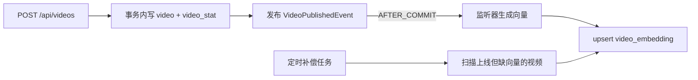

# 向量模块实现

本轮补上推荐链路的第一个前置件：视频内容向量。原 Go 项目里它是 `application/embedding` + `domain/embedding`，通过 RabbitMQ 的 `video.published` 队列异步触发；本版本不引入 MQ，改为进程内发布事件 + 定时补偿，接口契约与消费逻辑保持一致，后续换成消息消费者时不需要改业务代码。

## 为什么它是前置件

推荐排序的相似度项 `similarity = cosine(用户兴趣向量, 视频向量)` 依赖两份向量：

- **视频向量**（本模块产出）——没有它，`similarity` 恒为 0，有用户向量时也走不出权重 0.70 那一条；
- **用户兴趣向量**——由曝光模块的 `video_view_events` 与 `video_embedding` 联查加权得到（`05` 文档 §6.4）。

因此向量是 `exposure` 和 `recommendation` 的共同输入，必须排在两者之前。

## 实现

| 组件 | 位置 | 职责 |
| --- | --- | --- |
| `Vectorizer` | `modules/embedding/service` | 文本转向量的能力抽象，换模型只换实现类 |
| `HashNgramVectorizer` | `modules/embedding/service` | 128 维本地哈希 n-gram，零外部依赖 |
| `VideoPublishedEvent` | `modules/embedding/service` | 发布事件载体，接 MQ 后即是消息体 |
| `EmbeddingService` / `Impl` | `modules/embedding/service` | 单视频生成、批量补偿 |
| `VideoEmbeddingRepository` / `Impl` | `modules/embedding/repository` | 向量 upsert 与批量读取，JSON 与数组互转 |
| `VideoPublishedEmbeddingListener` | `modules/embedding/listener` | 事务提交后触发向量生成 |
| `EmbeddingBackfillJob` | `modules/embedding/job` | 定时补偿上线但缺向量的视频 |
| `EmbeddingConfiguration` | `config` | 装配默认向量器，维度可配 |

## 向量算法：与 Go 版逐位一致

算法本身沿用 `hash-ngram-v1`，128 维：

1. 文本归一化：转小写，只保留字母和数字，其余字符压成单个空格；
2. 特征提取：空格分词的词元（前缀 `tok:`）+ 去空格后 2-gram、3-gram；
3. 哈希落位：FNV-1a 64 位哈希 → 无符号取模选维 → 最高位定正负（符号哈希）；
4. L2 归一化。

**为什么要逐位对齐**：`video_embedding` 表按 `(video_id, model)` 唯一，两端若并行运行会共用这张表。哈希只要有一点差异（有符号取模、UTF-16 编码、换哈希函数），Java 端算出的向量与 Go 端就不可比较，而表现只是「推荐结果悄悄变差」，不会报错。因此测试直接锁定了 FNV-1a 的落位与符号：

| 特征 | FNV-1a 无符号值 | 维度 128 的落位 | 符号 |
| --- | --- | --- | --- |
| `tok:hello` | 9798042355776799051 | 75 | −1 |
| `he` | 628906390544363382 | 118 | +1 |

两处实现细节容易写错：

- **取模必须按无符号**：`hash & Long.MAX_VALUE` 再取模，与 Go 的 `int(hash % uint64(n))` 等价。用 `Math.abs(hash % n)` 会在 `Long.MIN_VALUE` 上溢出，直接得到负数下标。
- **哈希按 UTF-8 字节**：与 Go 的 `[]byte(feature)` 一致，按 `char` 或 UTF-16 处理会算出不同结果。

**符号哈希的意义**：同一个特征落哪一维、取什么符号都由哈希决定。两个不同特征撞到同一维时可能相互抵消，而不是无脑累加——后者会让所有向量趋同、区分度下降。

## 触发路径



**为什么在提交后才生成**：事务内生成会让回滚留下一份指向不存在视频的向量；换成真实模型后还是一次网络调用，会把下游耗时算进数据库事务。监听器用 `@TransactionalEventListener(phase = AFTER_COMMIT)`，并设 `fallbackExecution = true`，让无事务场景（单条写入、测试直接调用 Service）也能正常处理。

**为什么失败只记日志**：向量是派生数据。视频已经发布成功，不能因为向量生成失败就把发布请求对外表现成失败。失败由补偿任务兜底。

**补偿任务为什么必须有**：覆盖三类缺口——事件在提交后、监听器执行前进程退出；单次生成抛异常；功能上线前已存在的历史视频。事件链路正常时它扫不到数据，开销只是一条带索引的查询。

**循环分批而非一次跑完**：历史视频可能很多，一次扫全表会长时间占用连接。每批处理后重新查询，已补齐的视频不会再被选中，天然向前推进；`backfill-max-batches` 约束单次任务时长，剩余部分下一轮继续。

## 与数据库的交互

建表语句沿用 `sql/schema.sql` 的 `video_embedding`，未做结构迁移。

**手写 SQL 的取舍**：本模块 Mapper 有三处手写 SQL，都落在 `01-代码规范与迁移对照.md` §4.3 的判据内：

| 方法 | 判据 | 说明 |
| --- | --- | --- |
| `upsertEmbedding` | 数据库专有语法 | `insertOrUpdate` 是两步操作且有竞态窗口，必须用单语句原子 upsert |
| `findVideoIdsMissingEmbedding` | 多表 JOIN | `LEFT JOIN ... IS NULL` 筛选缺失向量，Wrapper 无法表达跨表存在性判断 |
| `findVideoTexts` | 只取部分列 | 补偿任务不需要 `media_url` 等长字段 |

**关于 `findByVideoAndModel` 与 `findByVideoIdsAndModel`**：按判据这两个单表查询本可以用
`LambdaQueryWrapper` 表达，这里**有意保留注解 SQL**。本模块的读写全部围绕 `(video_id, model)`
这一对键，把取数与 upsert 放在同一文件里连续阅读，比一半 Wrapper 一半注解更容易核对键的用法。
这是可读性上的主动选择，不是遗漏——后续新增单表查询仍应优先用 Wrapper。

- **upsert 用 `ON DUPLICATE KEY UPDATE`**，依赖 `uk_video_model`。MySQL 8.0.20 起 `VALUES(col)` 已废弃、推荐 `AS new` 别名形式，而 H2 的 MySQL 兼容模式只认旧写法。测试跑 H2、生产跑 MySQL，因此 Mapper 用 `_databaseId` 分支二选一，`DatabaseIdProvider` 在 `MybatisPlusConfiguration` 注册。
- **JSON 列读取差异**：MySQL 取出来是裸的 `[0.1,-0.2]`，H2 会额外包一层 JSON 字符串引号，取出来是 `"[0.1,-0.2]"`。Repository 先判断是否被引号包住，是则再解一层，让两种数据库结果一致。
- **损坏向量不阻断查询**：解析失败或维度对不上时按「无向量」处理，只影响单个视频，补偿任务会发现并重建。

## 配置

| 配置项 | 默认值 | 说明 |
| --- | --- | --- |
| `gcfeed.embedding.dimension` | 128 | 向量维度 |
| `gcfeed.embedding.backfill-batch-size` | 200 | 补偿任务每批处理的视频数 |
| `gcfeed.embedding.backfill-max-batches` | 20 | 单次任务最多跑多少批 |
| `gcfeed.embedding.backfill-interval-ms` | 600000 | 补偿任务间隔 |

**改维度必须同时换模型标识**：`uk_video_model` 以 `(video_id, model)` 为键，维度变了却沿用 `hash-ngram-v1`，新旧向量会被判为同一份互相覆盖，长度不一致的向量混在一张表里。

## 保留的扩展点

`VideoServiceImpl.createPublished` 中原来的 `TODO(RabbitMQ)` 注释保留，并在其前补充了进程内事件发布。接入 MQ 时：

1. `VideoPublishedEvent` 直接作为消息体，字段不用改；
2. `VideoPublishedEmbeddingListener` 改成 `@RabbitListener`，或新增一个 MQ 监听器替换它；
3. 发布动作从 `eventPublisher.publishEvent` 换成 Outbox + 提交后可靠投递，补偿任务继续保留作为最终兜底。

## 验证

```bash
./mvnw -o test
```

全量 80 个测试通过（本模块新增 13 个）。

| 用例 | 覆盖点 |
| --- | --- |
| `vectorIsDeterministicAndNormalized` | 同一文本两次结果一致、维度正确、L2 范数为 1 |
| `blankTextReturnsZeroVector` | 空文本、纯空白、纯标点返回零向量 |
| `similarTextScoresHigherThanUnrelatedText` | 相似文本的余弦相似度高于无关文本，自身相似度为 1 |
| `normalizationIgnoresCaseAndPunctuation` | 大小写与标点差异不影响向量 |
| `dimensionIsConfigurableAndMismatchedVectorsScoreZero` | 维度可配，维度不一致或空向量返回 0 |
| `hashFeaturePositionsMatchGoImplementation` | FNV-1a 落位与符号与 Go 版一致 |
| `hashMatchesGoForKnownFeatures` | 无符号取模，不出现负数下标 |
| `publishCreatesEmbeddingRow` | 发布后事件生成向量，模型、维度、文本哈希正确 |
| `regenerateOverwritesSameRow` | 重复生成覆盖同一行，不产生第二份 |
| `unusableEventIsIgnored` | 空事件、非正视频 ID、空标题不写入 |
| `backfillFillsMissingAndSkipsExisting` | 补偿只补齐上线且缺向量的视频，跳过下架视频 |
| `backfillWithNonPositiveLimitDoesNothing` | 非正 limit 不处理 |
| `findVectorsSkipsMissingEntries` | 批量读取时缺失项不影响其他项 |

**未覆盖**：真实 MySQL 的 JSON 列往返与 `ON DUPLICATE KEY UPDATE` 别名语法。H2 走的是另一条分支，需要在部署环境做一次接口联调确认。
